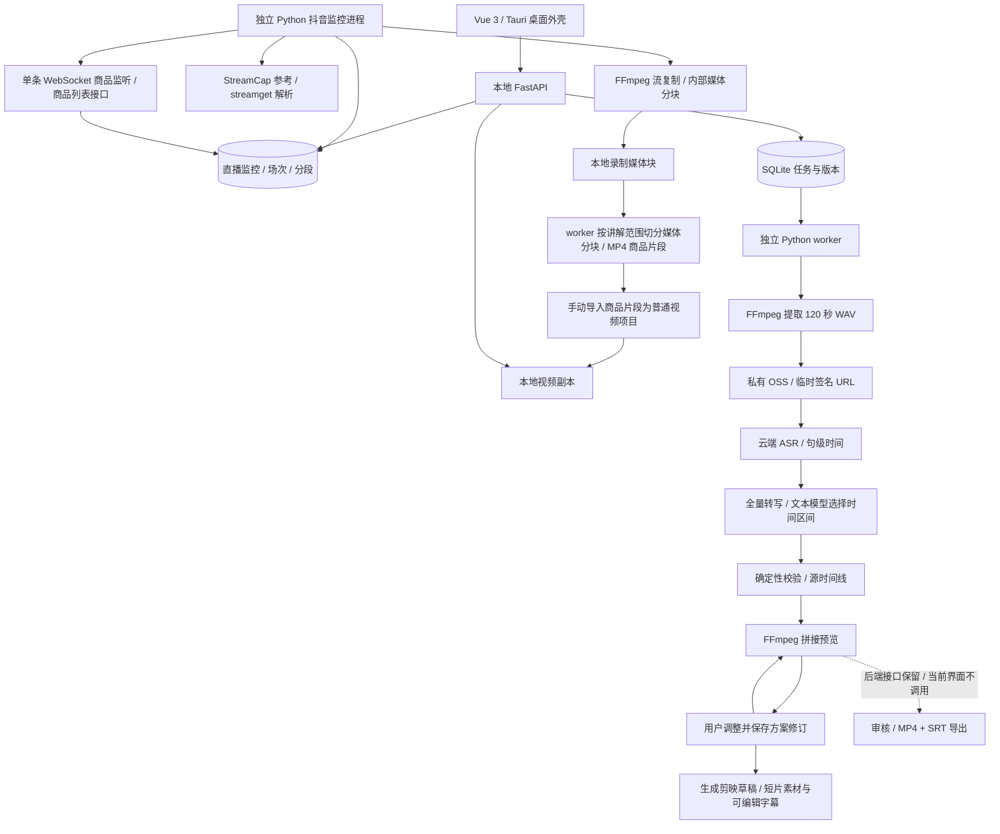

# 技术架构与运行边界

[返回项目规格与文档入口](index.md)。维护规则和迁移来源见索引；原章节编号保留用于追溯。

## 3. 技术架构

### 3.1 工程目录

- 后端按业务职责组织为 `core`、`ai`、`media`、`projects`、`live_monitoring`、`product_platform` 与 `integrations` 包；`product_platform` 集中请求协议、登录 / 范围状态与搜索服务，`api.py`、`worker.py`、`cli.py` 作为应用入口和编排层保留在 `app` 根包。抖音 WebSocket 协议实现单独位于 `douyin_product_events`，第三方剪映草稿库位于 `_vendor`，不混入本项目业务模块。
- 前端沿用 `views`、`components`、`composables`、`stores`、`services` 分层；验证脚本归于 `desktop/scripts`。`data`、`.runtime`、虚拟环境、Node 依赖和构建输出属于本机运行产物，不作为源码目录重组。

### 3.2 运行边界

- Python 为核心，uv workspace 管理 `.venv`、依赖组与 `uv.lock`；`backend` 为成员包。
- Vue 3 + TypeScript；pnpm 10，packageManager 固定版本，`pnpm-lock.yaml` 管理依赖。
- 前端使用 Vue Router 4 的 hash 路由和 Pinia 3。页面入口与状态见 [§7.1](api.md#71-前端路由与页面状态)；项目列表筛选条件保存在 URL，支持直接打开、刷新、前进和后退。
- Pinia 仅保存会跨页面共享的会话、项目列表、当前项目和任务状态；视频播放器引用、文件选择器、设置页表单草稿与密钥明文保持组件本地，不写入 Pinia 或浏览器持久化。
- FastAPI / Pydantic 处理本地接口、认证和校验，SQLite 保存元数据、版本、任务、租约和缓存。
- API 与重型媒体 / 云端工作进程隔离。FFmpeg / ffprobe 负责探测、音频、裁切与拼接，进程参数用列表，不拼接 shell。
- 本版无需 LangChain、LangGraph、Redis 或 Celery，也不部署本地 AI 模型。
