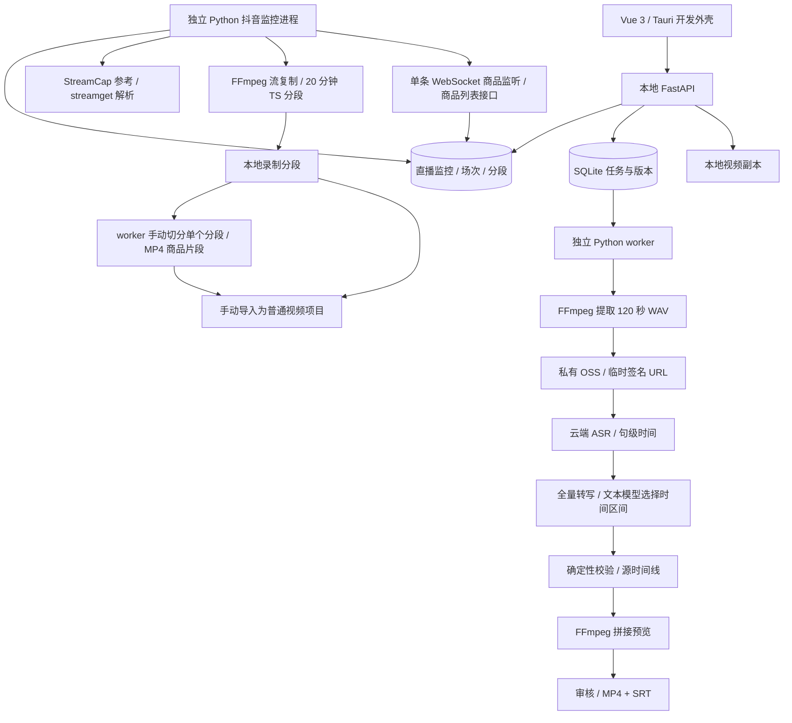

# DouyinCut 产品与技术规格

- 版本：0.2.107
- 日期：2026-11-05（Asia/Shanghai）
- 状态：当前开发与验收基线
- 平台：Windows；Python / uv、FastAPI、Vue 3 / pnpm、Tauri 开发外壳

本文件是当前开发、测试和验收的依据。变更流程、模型协议或产出目标时同步修改本文件。真实云端能力与模型效果须单独验证，不能以模拟测试宣称通过。

Windows 应用打包规格与分票记录见 [Windows 应用打包](.scratch/windows-packaging/spec.md)。当前目标是用户个人本机安装和使用，不包含商店上架或公开分发。工单 01、03、04 已完成当前范围验收；工作目录准备仍有验收缺口。托盘首次关闭提示、恢复、同会话重复启动且进程数不变、退出后进程清理及剩余隐藏活动 / 用户隔离验证已获用户反馈正常，工单 04 标记为 `resolved`。本文不把这些能力等同于安装包的完整验收。

工单 03 的冻结媒体运行时固定使用随包 FFmpeg / ffprobe 8.1，启动前校验工具、许可证、上游说明和媒体来源清单的哈希，不读取全局 PATH 或开发媒体环境变量作为回退。Gyan 发布 ZIP 已按官方 SHA-256 校验，其 FFmpeg、ffprobe、许可证及 README 成员哈希与锁定运行时一致；固定 FFmpeg 主源码及许可证已取得。Gyan 静态构建其余外部库完整源码、精确许可证和构建配方仍未齐备，因此 `redistribution_ready` 保持为 `false`，仅表示尚未完成公开再分发准备；不影响工单 03 在个人本机使用范围内标记完成。原生文件选择器导入已获用户确认正常；隔离合成视频的导入任务、6 秒 / 160×120 探测结果、导入副本归属及原视频哈希已只读核对。当前无付费自动验收使用成功缓存 fixture；资源来源、构建步骤和验收状态见 [Windows 随包媒体工具](docs/windows-media.md)。

## 开发与数据策略

- 添加或修改功能只以当前方案和数据协议为准，不兼容应用历史版本；同步调整前后端与文档，不保留旧接口、字段、任务、缓存解析或数据库迁移分支。
- 开发规则持久化于 `AGENTS.md`。协议变化需要清空业务数据时须获得用户明确授权；本条不授权以后自动清空新素材。
- 2026-10-14 按用户要求清空本地已有素材记录、商品、转写、候选、方案、任务、缓存与生成文件；保留云端连接设置、系统密钥及用户原始视频。OSS 远端对象不在本次本地清理范围内。
- 当前方案修订、同版本任务恢复与防重复计费继续保留；Windows / WebView 和云端接口的支持按实际需求验证。

## 1. 目标与使用前提

**输入视频主要讲同一款商品**，用户填写商品资料，应用根据口播识别与剪辑要求，生成约一分钟的粗剪并自动拼接预览，确认后导出 MP4 和 SRT。

当前主流程：视频项目列表 → 新建并选择本地视频，或从直播监控导入已封存分段 / 打开已有项目 → 填写商品名称、剪辑要求、目标时长与允许偏差 → 分段 ASR → 汇总全量对话与源时间戳 → 文本模型选择时间区间 → 自动拼接预览 → 调整 / 重新粗剪 → 确认导出。

- 商品名称必填，示例：独束分身型微定制【奶黄千层】假两件针织开衫。
- 编辑页不再提供“补充信息（可选）”，当前项目草稿、分析请求及模型提示中移除此字段。商品事实以源视频口播为准，不能编造视频中没有的内容。
- 默认剪辑要求：“保留上身效果、版型、面料和穿着感受的介绍，去掉价格、优惠、催单、无关互动及重复口播，保持表达完整，生成约 60 秒的视频。”可修改；空白使用内置要求。“保存为默认”独立于分析执行，将当前要求保存到本机应用设置并同时保存当前项目草稿，后续新项目和未填写要求的项目自动使用；已有项目的已保存要求仍优先。分析失败不回滚默认要求，刷新或重启后继续保留。
- 默认目标 60 秒，界面可选 90 秒。素材不足生成较短版本；允许偏差通过滑块以 1 秒为步长在 0–30 秒调整，默认 15 秒，实时显示 ±N 秒与建议时长范围。滑块采用 daisyUI 的 Range with custom color and no fill 形式：主题主色滑块、主题分隔色轨道，关闭进度填充，浅色 / 深色随主题适配。模型优先落在目标 ± 偏差内，素材不足可更短；实际总时长不得超过目标 + 偏差，超出要求重新选择。
- “上身效果 / 面料”指相关口播，本版未检查画面是否正在展示相应内容。
- 本版不调用视觉模型、不抽帧、不识别或合并多款商品，不要求手动建立商品、确认归属或标注候选。
- 抖音直播监控（首版，详见 §2.4）：开播自动录制 20 分钟 MPEG-TS 分段，记录商品讲解切换，用户可手动将已封存分段按商品讲解区间切分为商品片段。原始分段与商品片段均可手动导入为视频项目，导入后由用户填写商品资料并主动启动 ASR / 粗剪，不自动调用模型。抖音解析参考 StreamCap 的公开实现并依赖 `streamget`；平台接口易变化，真实账号 / 开播及 FFmpeg 音画需单独验证。
- 剪映草稿（详见 §2.3）：可将已保存的粗剪方案及字幕生成剪映可编辑草稿；实际剪映 11.6.0 打开验证仍须单独完成。
- 暂不纳入首版验收：主播主页链接、跨批次商品池、直播断线自动续录、多直播间并行可靠性、视觉理解与应用内字幕编辑。
- 长期设计保存在 [docs/FUTURE_DESIGN.md](docs/FUTURE_DESIGN.md)，不构成本版验收要求。

## 2. 界面与操作

所有页面共用全宽主内容区，使用侧栏以外的窗口可用宽度，保留正常左右内边距，不设置固定最大宽度。侧栏依次为直播监控、素材与粗剪、视频项目、后台任务、外观、云端设置、本地设置，均在 4K 及缩放后的窗口随可用宽度扩展；表格、卡片与设置网格填满主内容区。窄屏侧栏与页面断点沿用当前响应式布局，避免整页横向溢出。

前端引入 Tailwind CSS 4 与 daisyUI 5，采用 Vite 插件和 CSS-first 配置，不增加 Tailwind 配置文件。daisyUI 默认主题保持浅色，并与现有蓝灰主色、底色和文字色对应。迁移时逐页使用语义组件类；基础 button / input / select / textarea / label 规则置于 Tailwind base 层，使 daisyUI 组件层正常生效。视频项目页的卡片、表格、筛选控件、操作按钮、状态标签与分页已接入；项目筛选工具栏与新建操作同排显示，保留名称双行展示、滚动容器及空状态，鼠标聚焦不显示额外描边，键盘焦点仍可见。直播监控页的统计、卡片、按钮、字段、筛选组、状态标签和告警已接入；直播间选择项、商品时间线、录制分段行及文件路径披露保留专用结构。

侧栏导航项显示对应图标；底部以单行显示本地服务状态图标和语义版本号，状态说明通过悬停提示提供。“外观”作为独立侧栏页面，提供跟随系统、浅色、深色三种主题选择，默认跟随系统。主题选项靠左排列，每项最大宽度 220px、间距 14px，预览保持 16:9；窄屏单列时仍限制宽度，避免图片随窗口拉大。主题选择保存在当前浏览器 / WebView 本地，重启后恢复；跟随系统时即时响应系统配色变化，显式选择浅色或深色时保持所选模式。外观页另提供“记住窗口位置”和“启动窗口大小”：位置记忆默认开启，关闭后清除已保存位置并在下次启动居中；保存位置若不再与任何显示器有足够交集则居中打开。启动窗口大小默认 1440×810，并可选 1920×1080、2560×1440；三种预设均为 16:9，选择后立即调整窗口并保存为后续启动大小。关闭窗口位置记忆时启动位置居中；用户仍可在运行中手动调整窗口大小。窗口偏好保存在本机应用配置目录，各页面、日期选择器和弹出层统一跟随主题；浅色模式侧栏为白色，深色模式侧栏为近黑色并与主体底色区分，视频背景保持深色。

全局操作成功 / 失败提示统一使用 daisyUI Toast，固定显示在右上角，最多堆叠 4 条；成功提示 6 秒、错误提示 9 秒自动关闭，并提供手动关闭。与具体内容绑定、需要持续查看或就地处理的诊断 / 字段校验仍显示在所属区域。

### 2.1 视频项目

默认进入“视频项目”页，每个导入的源视频是一个项目，重新粗剪产生的多个方案归入同一项目。列表由后端分页，每页 20 条，按最近活动时间倒序；支持视频名称 / 商品名称搜索和状态筛选，改变筛选回到第一页。返回列表保留搜索条件和页码。

表格限高独立滚动，表头固定，分页控件位于表格外。窄屏搜索栏换行，表格允许内部横向滚动，不撑宽整个页面。

每行首先以上方较大字体显示商品名称，下方以较小的弱化字体显示视频名称；未填写商品名称时显示明确占位。其余列显示源视频时长、处理状态、成片时长、最近更新时间，操作列及其“查看 / 继续编辑”和删除按钮靠右对齐；行内增加留白。列表卡片铺满页面剩余高度，不随条目数量收缩，表头固定、条目在卡片内部滚动，分页位于卡片底部；窄窗口仅表格内部横向滚动。工具栏将搜索与新建视频项目按钮紧邻排列，搜索使用柔和蓝色，新建保留主操作色，窄屏自动换行。成片时长按最新方案的片段时长合计，无方案显示空；“已完成”表示最新方案当前版本已有拼接预览或导出结果，不表示用户已审核。任一相关活动任务优先显示“处理中”，其次为“已暂停”，最近失败 / 取消任务显示相应状态，其他无当前产物的项目显示“待剪辑”。

“新建视频项目”打开系统文件选择器，导入探测完成后自动进入该视频的素材与粗剪。查看项目恢复商品名称、剪辑要求、目标时长、允许偏差和最新方案 / 预览；同源的其他方案仍可选择。编辑页只加载当前源视频及其候选、方案、产物、最近 50 个相关任务（活动 / 暂停优先），最新分析独立返回；全量 ASR 对话按需获取，不加载整个素材库。

商品名称、要求、目标时长和允许偏差保存在项目草稿中，可显式“保存项目设置”；“保存为默认”另外持久化可跨新项目复用的剪辑要求；离开编辑页、打开其他项目、新建视频及提交分析前保存，失败时留在当前页并提示。后台刷新不覆盖输入或未保存的片段调整。返回列表再进入同一项目保留当前会话的片段草稿；片段需通过原“保存调整”按钮持久化，有未保存片段时阻止打开其他项目 / 新建视频。刷新浏览器后的恢复以已保存数据为准。项目切换不会触发云端分析。

### 2.2 素材与粗剪

工作台使用全宽，桌面采用左侧素材 / 商品资料与右侧剪辑区。两个卡片之间提供可拖动分隔条：左侧最小 230px、右侧最小 360px，拖动结束后在当前浏览器 / WebView 本地记住宽度；双击或 Enter 恢复默认，方向键每次微调 20px，Shift + 方向键调整 50px，Home / End 调到边界。窗口缩小时自动限制宽度，850px 及以下上下排列并隐藏分隔条。切换页面或卸载时释放拖动捕获。右侧内部并排显示成片预览和入选片段，不把全部片段堆在播放器下面。左侧资料和片段列表各自限高滚动，保存 / 导出操作置于列表外的底部，不随片段数量向下推移。

片段卡片紧凑展示编号、源时间范围、时长、入选理由、两行口播摘要；点击展开可查看完整口播。开始 / 结束输入与上移、下移、移除集中于同一行；保持完整文本和原有编辑能力。原素材置于预览列顶部并直接展示，拼接成片置于其下方；全部粗剪方案在默认展开的方案列表中展示，默认选中按创建时间倒序排列的最新方案，点击方案即切换当前预览与片段编辑内容，并以“方案序号 · 时长 · 修订号”区分独立方案与其内部修订。每项可单独删除；确认后删除该方案的本地预览、导出文件及独占候选 / 商品，保留源视频、ASR 对话及其他方案；活动预览 / 导出任务期间拒绝删除。根据剪辑区实际宽度切换并排 / 上下排列，窄屏切点与操作允许换行，避免水平溢出。

左侧放视频选择、商品资料、要求、任务状态及全量 ASR 对话；右侧预览列上方显示原素材 / 源片段播放器，下方显示拼接成片播放器，两者直接展示并明确标注；成片显示片段数量和总时长，入选片段在旁侧展示源区间。点击播放源片段使用上方播放器，拼接成片继续使用下方播放器。宽屏双栏，窄屏顺序排列。浅色模式使用浅灰页面、白面板、深灰侧栏与蓝紫强调色；深色模式使用深色页面和面板、浅色文字，视频使用中性深色背景。

点击按钮打开系统文件选择器，替代手动输入路径。浏览器 / Tauri WebView 选中文件后，通过带认证的本地接口流式复制到项目素材目录；原视频不上传云端、不修改原文件。显示文件名、时长、分辨率和本地预览，后台探测完成自动选中新素材。浏览器模式会增加一份本地视频副本。

商品名称必填，剪辑要求可单独“保存为默认”，允许偏差用拖动条设置；一个分析任务完成 ASR 与文本选片，成功后自动排队 FFmpeg 拼接预览。同一素材已有活动粗剪任务时拒绝重复提交。切换素材应展示该素材的方案和最近填写信息。

逐段展示原话、入选理由、开始和结束秒数；允许播放源片段、删除、重排、在候选范围内微调切点。至少保留一段。保存调整重建连续时间线和字幕，生成新版本预览；旧预览不能代表调整后的版本。未保存的调整不能导出。初次确认导出前须有当前版本预览，最终产物也可直接播放。

修改商品资料 / 要求后再次分析生成独立方案，保留旧方案，优先复用转写。重复刷新不能污染正在编辑的草稿；草稿与已保存方案独立。

### 2.3 任务与交付

后台任务页使用铺满页面剩余高度的卡片，标题与底栏固定，任务在卡片内部滚动。按创建时间倒序、同时间按任务 ID 倒序稳定排列，每次展示 20 条；接近底部时自动追加下一批，保留“加载更多”按钮用于手动操作。采用创建时间和 ID 组成的游标读取，避免新增任务造成翻页重复或跳项；加载失败保留已有任务并显示“重试加载”，无更多记录时显示已加载全部。状态事件刷新已加载范围，保留列表及可见任务的位置，不回到第一页；进行中数量使用全部任务汇总。每条显示任务类型、状态标签、短 ID、创建时间、进度百分比与进度条，错误详情和原有暂停 / 恢复 / 重试 / 取消操作保留，操作靠右。向下滚动超过 240px 后在底栏显示“回到顶部”，点击滚动当前任务列表，尊重系统减少动态效果的设置。窄屏任务行纵向排列。

任务页展示导入、语音粗剪、预览、导出进度和任务控制。支持持久化暂停 / 恢复、取消、重试；暂停在检查点生效，不能声称立即中断已提交云端请求。

不再设置独立“预览与交付”页面。审核后在当前项目编辑页触发最终导出；工作台下方“04 / 导出结果”展示该源视频的 MP4 / SRT 文件位置、输出目录及历史成片。只展示最终 MP4 导出，自动预览留在上方拼接播放器；同源不同方案 / 修订的成片保留，标注方案 ID、版本、时长和“当前版本 / 历史成片”，支持展开播放。最近成片默认展开，历史记录限高滚动，路径可选中复制。切换项目只展示所属成片，不额外查询全局导出列表。字幕文件固定为导出目录内的 `subtitles.srt`。当前可从保存的方案修订生成剪映草稿，路径显示在当前项目任务区；MP4 导出接口只接受 MP4。

剪映草稿为独立工程目录，优先写入 `DOUYINCUT_JIANYING_DRAFTS_DIR` 指定位置，否则探测 `%LOCALAPPDATA%\JianyingPro\User Data\Projects\com.lveditor.draft` 或 `%LOCALAPPDATA%\Jianying\User Data\Projects\com.lveditor.draft`。草稿目录名不超过 36 个 ASCII 字符，避免剪映截短目录名后使绝对素材路径失效。每个入选区间先编码成独立视频并复制到草稿 `Resources`，再作为单独时间线片段引用；不复制整段直播。方案已有字幕时，每条字幕作为独立、可编辑的普通文字片段写入置顶文字轨，使用白字黑描边、居中下方和自动换行；字幕时间按编码后视频片段的实际时长映射，避免帧级时长差异造成逐段偏移。原生逐字跳动字幕模板当前未接入：必须取得剪映实际下载的模板包及依赖，并按其模板工程结构生成，不能把字幕模板 ID 当作普通花字效果 ID。无字幕方案不创建空文字轨。生成结果记录工程目录、方案修订、视频片段数、字幕条数与成片时长。草稿绑定当前已保存方案 ID 与修订，要求先保存片段调整。工程文件不随项目 / 方案删除自动清理，因为用户可能已在剪映内继续编辑；相关活动生成任务期间拒绝删除源项目 / 方案。生成采用后台可恢复任务。

### 2.4 抖音直播监控

#### 页面

- 页面采用“状态概览 → 直播间列表 / 选中直播间详情”的主从布局。顶部展示直播间总数、正在录制、正在直播、需要关注的直播间数量；异常统计检查监控错误及最近场次的商品列表 / 活动商品连接错误。“添加直播间”按钮打开弹窗，填入链接与可选备注；弹窗支持 Esc、点击遮罩及取消按钮关闭，成功添加后自动关闭。桌面端工作区填满主内容区剩余高度，直播间列表、商品讲解变更和录制分段分别在卡片内滚动；窄屏恢复页面自然滚动。页面采用灰白底、蓝色主操作、柔和红色录制状态、暖米色当前商品提示；颜色与文字共同表达状态。
- 左侧直播间卡片支持按名称 / 链接搜索及全部 / 开播中 / 录制中 / 异常筛选，开播中优先，默认选择正在录制的直播间，否则选择首个；选择后在刷新时保留。列表项只显示名称、异常标记、开播状态、录制状态和场次数，不显示商品。开播状态取最近一次检测结果，标签在前：已开播 / 未开播；检测失败显示“检测异常”，尚未检测显示“等待检测”，悬停显示检测时间。只有正在录制时才额外显示“录制中”标签。卡片底部固定展示所选直播间：名称、链接、最近检测、录制策略、当前设置摘要、检测异常及录制 / 移除操作；最近检测显示“最近检测 MM/DD HH:mm:ss（x分钟前）”，分钟数向下取整且不小于 0，每 5 秒更新，尚未检测时显示“最近检测 尚未检测”；直播间链接在系统默认浏览器打开，录制中移除按钮禁用，须先停止录制。列表每 5 秒同步，开播检测仍为 20 秒。
- 每个列表项右上角有设置图标，点击展开浮层，可分别开关“开播自动录制”和“开播提醒”（Windows 通知）。设置保存后立即生效，新添加的直播间默认两项都开启。
- 录制操作按设置显示：开启自动录制且未手动停止时，只显示“发生开播后自动录制”的说明，不显示开始按钮；关闭自动录制、或本次直播已被手动停止时显示“开始录制”，录制中显示“停止录制”。开始录制仅在直播间已开播时可用，未开播时按钮禁用并提示。
- 右侧顶部为横向录制时间线，替换原场次下拉框，默认展示当前直播间今天 00:00–24:00 的录制活动，选择日期后展示所选日期全天。每个时间段代表一次录制场次，保留停录间隙；刻度按本机时间显示 00:00、06:00、12:00、18:00、24:00。跨窗口场次只绘制交集并标记延续，说明展示完整起止时间、完整时长和状态；录制中显示“至今”，完整时长和区块终点计算至当前时刻，未来时段保持留空。同一天每 5 秒成功刷新后只更新内容，不移动窗口边界；默认今天模式跨午夜后展示新一天。点击时间段选择整个场次；下方说明使用纯信息容器展示，不响应点击、悬停或焦点变色，总时长使用主题强调色和加粗文字突出显示；悬停区块加深对应状态颜色并显示内描边，键盘聚焦也提供明确反馈，仅预览说明，不改变选择或区块尺寸；选中场次保留高亮。默认选择窗口内录制中场次，否则选择开始时间最晚的场次，切换直播间重新选择；轮询和新场次不抢占手动选择。今天无场次时显示“今天无录制，可选择其他日期”，下方三个卡片为空，不回退到窗口外历史场次。已选场次因跨日移出窗口时保留三个卡片，通过稳定标识持续更新详情，提示“所选场次已不在当前时间范围内”，可点击“查看该日期”进入该场次开始日期的自然日窗口。仅在详情读取成功且明确不存在时，回退至窗口内开始时间最晚的场次；无候选则清空。请求失败保留上次成功的窗口和内容，显示失败状态；切换直播间、选择或卸载后忽略旧请求结果。时间线持续保留选中场次的完整说明，包括其移出窗口之后；悬停或键盘聚焦其他场次只预览说明，指针离开不清除键盘焦点对应的说明。
- 时间线使用 daisyUI Calendar（Cally）与 Dropdown 展示中文日期选择器，按钮默认显示今天日期，日历默认选中今天；点击日期按钮展开日历，选中后收起；点击外部或按 Esc 关闭，支持清空日期。允许选择今天及更早日期，未来日期禁用。所有日期窗口按本机时区从当天 00:00 至次日 00:00 计算，夏令时日期遵循实际自然日长度；历史日期固定不随轮询或跨日改变。清空日期、选择今天或点击“回到今天”恢复默认今天模式，并在跨午夜后跟随新一天。切换日期保留仍相交的已选场次，否则选择窗口内开始时间最晚的场次；无场次显示“当天无录制”，下方三卡片为空。切换直播间保留日期，并按新直播间窗口内录制中优先、否则最新的规则选择。“回到今天”按钮固定显示，当前已是今天时禁用。每五秒后台同步不禁用日期控件、不插入可见读取提示，保持按钮布局和样式稳定；期间切换日期会使旧同步结果失效。仅首次加载或日期切换查询期间暂时禁用日期操作，读取状态通过无障碍提示表达，成功后同时更新窗口标识与内容；失败时保留原窗口并恢复日期，报告错误。直播间正在录制的状态和开始 / 停止控制根据直播间实时状态判断，不依赖日期窗口的场次列表。
- 场次记录结束时间来源 `end_time_source`：录制中为 null，正常停止或运行中检测到失败为 `observed`，应用启动恢复检查封存的异常场次为 `recovery_check`。列表和稳定标识详情查询均返回该字段。仅对 status=failed 且来源为 recovery_check 的场次显示“异常结束，结束时间可能晚于实际停录时间”；其他失败仅显示“异常结束”。录制活动时间不代表精确媒体覆盖范围，不追溯旧数据的实际停录时刻，不新增历史数据库迁移或兼容分支。
- 时间线下方“录制分段”“商品讲解”“商品视频片段”三张卡片等宽并排，各自限高滚动；左侧直播间“当前选择”区域及三张卡片底部说明栏使用与所属卡片一致的主题底色（base-100），不使用页面灰底，浅色、深色模式均保持在卡片内部的视觉连续性；容器宽度不足时变为两列，窄屏单列。窄窗口直播间列表改为横向卡片选择，不产生整页横向溢出；页面不限制最大宽度。时间线使用按实际时长比例定位的专用图表结构，窄容器允许图表内部横向滚动。图表下方不再显示重复的逐场选择按钮，场次切换统一通过点击或键盘激活时间段完成，不合并或扩张图上的真实录制时长。说明始终只显示一张，不因场次数量增加而叠加高度。
- “商品讲解”卡片标题旁显示商品监听状态和讲解次数；移除独立的“正在讲解 / 场次结束时讲解”卡片，“讲解变更”改为“讲解列表”。列表以持久化讲解区间为准，首次讲解也显示，同一商品多次讲解分别列出；当前讲解置顶，其余按开始时间倒序。每条显示商品名称（缺失时显示商品 ID）、商品 ID、本场起止位置、已结束讲解时长、来源分段编号及可用状态、生成数量 / 待切数量 / 待封存部分 / 不足 1 秒说明。商品目录错误和监听说明仍保留在列表上方。首次商品从录制开始计是剪辑区间规则，不代表已验证主播实际开始讲解的时刻。
- “录制分段”支持全部 / 待导入 / 已导入筛选；保留导入、打开项目和确认删除，文件路径按需展开并可复制。每个分段可用系统默认播放器打开文件，或在文件夹中显示文件；操作仅允许访问直播录制目录内仍存在的文件。分段行操作默认显示图标，鼠标悬停或键盘聚焦时滑动展开文字；移除分段行的“切分商品”。相关讲解正在切分时该分段禁止删除并显示说明。
- 每条商品讲解采用左侧商品信息、右侧“切分商品”按钮的左右布局，按钮相对商品信息上下居中；时间与讲解状态在上方单独一行。仅切该次讲解与已封存分段的交集；跨段分别生成片段。当前讲解允许先切已封存部分，之后再次点击补切新封存部分。任务进行中禁用该条切分按钮并显示“切分中…”，失败原因显示在对应讲解下。全部来源已删除 / 丢失 / 异常时，点击提示没有对应可用录制分段；部分来源不可用时，先列出缺失分段编号及原因，用户确认“只切可用部分”后才提交剩余已封存来源；确认时来源再次变化须重新确认。没有已封存来源时提示等待封存，全部可用片段已生成时提示无需重复切分，不创建空任务。
- “商品视频片段”按分段倒序列出，每行显示商品名称（缺失时显示商品 ID）、状态（生成中 / 待导入 / 导入中 / 已导入 / 生成失败）、来源分段、所属讲解起止位置、片段在场次内的起止位置、时长、文件大小、失败原因及可展开文件路径；待导入显示“导入剪辑”，已导入显示“打开项目”，导入成功后将片段商品名称写入项目资料草稿。每个未失败的片段另有“打开”和“在文件夹中显示”；各片段可确认删除，生成中 / 导入中不可删除，已导入时只删监控记录并保留项目及其素材文件，未导入时同时删除片段文件；删除只允许操作直播录制目录内的片段。打开 / 删除路径不符或文件缺失时安全拒绝。页面内不嵌入片段播放器，避免 MPEG-TS 在浏览器 / WebView 中的兼容差异。空状态提示在讲解列表中点击“切分商品”。
- 监控备注名称可选；留空时首次解析直播间后使用抖音解析结果中的主播名称，解析前及解析不到名称时显示“抖音直播间”。用户填写的备注名称始终优先，不被自动名称覆盖。

#### 监控与录制

- 监控目标只接受抖音直播间链接或抖音分享短链，不支持主播个人主页。后台监控进程与普通有限任务进程分离；录制及监控不依赖前端页面持续打开，但应用 / 监控进程退出时不保证继续运行。
- 监控状态与录制状态分开：新增或启动后即对全部直播间每 20 秒检测一次开播，没有暂停检测；不再提供“暂停监控”操作，开播检测常开。
- 默认每 20 秒解析一次直播状态。开播时启动 FFmpeg，将音视频流直接封装为本地 MPEG-TS，每 1200 秒切换文件，不重编码。每次检测记录直播间是否开播及检测时间（`live_monitor_liveness`），与录制状态分开保存。录制目录为 `data/recordings/live/{monitor_id}/{session_id}/`；同一监控项的轮询只管理一个活动录制进程。
- 是否开始录制由设置决定：`auto_record` 开启时检测到开播即开始；关闭时需用户点击“开始录制”，该请求只对本次直播有效，直播结束后清除。用户点击“停止录制”会立即停止并封存，并把本次直播标记为已停止，之后即使 `auto_record` 开启也不再自动恢复，直到直播间离线；离线后该标记自动清除，下次开播按设置重新决定。
- 开播提醒：检测到直播间从离线变为开播时发送一次 Windows 通知中心提醒（标题为直播间名称，正文说明是否会自动录制），同一次直播只提醒一次，离线后重置。提醒开关按直播间保存在设置中；通知由后台监控进程通过 PowerShell 发送系统 Toast，不注册开机自启或常驻服务。
- 直播离线、用户停止录制或录制进程退出时停止 FFmpeg 并封存尾段；只有 ffprobe 可探测的已封存段才显示“导入剪辑”。单个分段导入复用当前 import 后台任务，成功后成为一个普通视频项目；用户在素材与粗剪页输入商品信息并主动启动分析。录制进程退出时按退出码区分正常封存与异常中断；异常退出保存退出码及 FFmpeg 日志末尾，监控项标记异常并保留中断标记，直播间离线后自动恢复，当前仍开播时也可手动开始录制。
- 状态包括等待检测、未开播 / 已开播、录制中、检测异常 / 录制失败；每个场次记录起止时间，每个分段记录文件路径、大小、时长、导入状态及关联视频项目。直播流 URL 不持久化，解析错误不保存临时媒体凭据。

#### 商品监听

- 当前录制场次使用单条 Python WebSocket 商品连接，不启动 Go 桥，也不建立并行影子连接。商品监听建立后立即异步 POST `/live/promotions/page/` 空请求体，按 `offset` / `limit` 遍历全部分页，解析 `promotions[].promotion_id` / `title` 和 `top_promotion`，初始化“当前讲解商品”。请求沿用会话 Cookie，并发送可从 Cookie 取得的 `webid`、`uifid`、`x-secsdk-csrf-token`；进程内所有商品列表请求全局间隔至少 1 秒，空响应 / 传输异常 / HTTP 408、429、5xx 最多请求 3 次。商品目录按录制场次保存于 SQLite；仅在完整分页成功后，以单个事务整表替换，网络 / 响应 / 分页失败时保留上次目录。请求失败时保存脱敏后的请求诊断、HTTP 响应正文或传输异常，并在商品区域显示红色可展开详情；分页异常还展示失败页游标和已收集条数。不保存 Cookie、CSRF 值或签名 URL。商品 ID 变化先查当前场次目录；未命中时异步刷新完整列表并再次查找，仍未找到或刷新失败则显示商品 ID。初始查询按请求开始时间落库，较晚返回的查询结果不得覆盖之后已收到的更新。首次观察到的 WebSocket 商品只建立基线，不伪装成切换事件；之后商品 ID 变化须由同帧或 5 秒内 `LivePopMessage` 中相同商品 ID 佐证，确认后写入正式商品事件表并同步更新当前商品，来源标记为 `python_live_shopping`。`WebcastProductChangeMessage` 暂不单独写正式事件。商品 ID、源时间戳、本地接收时间分别持久化。商品标题解析失败不影响商品状态，页面继续显示商品 ID；不在 WebSocket 收帧 / ACK 回调中等待 HTTP。讲解类型目前仍留空。页面展示当前 / 场次结束时商品、商品连接状态和正式变更事件时间线；不采集、保存或展示录制期间的商品消息诊断样本。商品事件监听只在录制场次内运行，停止 / 结束录制时关闭。
- 商品变更按场次持久化商品 ID、可用的商品名称、`explain_type`、直播消息时间与本地接收时间；事件列表用于核对讲解切换点。消息时间与接收时间相差超过 5 分钟时使用接收时间作为锚点。`explain_type` 保留原始值，不在真实直播样本确认前将其解释成开始 / 结束状态。
- 独立实验模块仍保留实时探针，用于单独报告 HTTP 会话、WebSocket 消息类型和 ACK；短链只允许 HTTPS 抖音域名逐跳重定向，日志不输出 Cookie 与签名查询串。`a_bogus` 与安装的 `streamget` 固定时钟向量一致；PushFrame payload 同时依据 `payload_encoding` 和 gzip 文件头 `1f 8b` 解压。Python 商品事件已在真实商品切换样本中验证，后续仍需核对长时间连接稳定性和商品事件时间与录制媒体时钟的误差。

#### 商品讲解区间与商品片段

- 当前商品 ID 每次变化（含初始化当前商品）都记录一个商品讲解区间：首个商品从本场录制开始计，后续商品从本机收到切换消息的时间计，并结束上一区间；场次停止时未结束的区间以停止时间收尾。仅更新商品名称不产生新区间，空名称区间会被随后查到的名称回填。
- 商品片段只由用户手动触发，录制结束不自动生成。`POST /live/product-periods/{id}/product-clips` 按单次讲解创建 `live_product_clips` 普通后台任务（任务页可暂停 / 取消 / 重试）；任务 payload 使用 `period_id`、`session_id`、本次已封存来源的 `windows` 快照，不再使用分段范围任务协议。同一讲解有活动任务时复用该任务；不同讲解的任务涉及相同分段时提示等待，避免同时转换同一工作素材。
- 来源关联、界面时间和任务窗口统一由讲解区间与连续分段的实际时长累计计算；保留已删除分段的时长参与累计，不按固定 20 分钟估算，不回退到文件扫描时间。分段编号按录制文件末尾的零起始序号加一确定，删除前段不会使后段重新编号。编号缺口或已封存分段时长未知时报告映射错误，拒绝按估算位置切分。
- 当前讲解与录制中分段仍显示关联，但只有已封存来源进入任务。冻结的窗口裁剪到源分段内，转换为该文件内本地秒数，至少 1 秒才生成。TS 分段在任务内转为 H.264/AAC MP4 工作素材，随后准确 seek 和编码输出 MP4；任务仅处理选中讲解，跨多个源分段各生成一个片段，不拼接。
- 部分来源缺失时返回 `state=confirmation_required`、`missing_segments` 和 `available_count`，不创建任务；请求体 `confirmed_missing_segment_ids` 必须与当前全部缺失来源 ID 集合一致才允许部分切分，新增缺失需要再次确认。没有任何可用来源且没有待封存来源时返回 409；等待封存、全部已生成或没有至少 1 秒的可切区间返回 `state=noop` 和中文原因，不创建任务。`GET /live/product-periods/{id}/split-plan` 与场次详情的 `product_periods` 使用相同的来源关联与任务状态。
- 片段写入该场次录制目录，文件名为 `商品片段_{分段序号}_{商品名}_{区间 ID 后 8 位}.mp4`；商品名去除 Windows 非法字符并截取 48 字符，为空时使用商品 ID。片段按（分段, 讲解区间）唯一，状态为生成中（processing）→ 待导入（completed）或生成失败（failed，保存异常摘要）；补切跳过已生成 / 导入中 / 已导入部分，只生成新封存、失败或中断的部分。全部片段失败时任务失败；部分失败保留片段错误。原始录制分段不被修改。
- 待导入片段通过 `POST /live/product-clips/{id}/import` 排入普通 import 任务，状态改为导入中，成功后为已导入并关联视频项目；导入任务失败或取消后恢复为待导入。
- 时间轴映射为“本机事件接收时间 − 本场录制开始时间”，对应连续封存 TS 的累计时长。商品源时间与媒体时钟误差、直播消息接收延迟和关键帧切点精度仍需真实录制验证。

#### 删除与数据

- 已封存 / 失败分段可从监控列表删除；操作删除位于直播录制目录中的本地分段文件及其转换工作素材，分段索引改为 deleted 并从录制分段列表隐藏；保留编号、时长和时间范围用于讲解关联，不重新编号。商品讲解记录及已生成片段不随源分段删除；讲解来源显示“已删除”或“文件不存在”，仍可点击切分获取提示或确认部分切分。录制中 / 导入中 / 正在切分商品片段的分段禁止删除；仍被视频项目引用的录制文件也禁止删除，须先删除关联视频项目。商品视频片段可单独删除；生成中 / 导入中禁止删除，未导入片段连同直播录制目录中的片段文件删除，已导入片段只删除监控记录并保留视频项目及其素材文件。
- 移除监控项会删除监控元数据、控制设置及场次、分段、商品事件、商品讲解区间、商品片段、当前商品、商品目录和监听状态索引，但永不删除本地录制文件、商品片段文件或已导入项目；正在录制时不能直接移除，先停止录制并封存。停止录制会终止当前 FFmpeg 进程、保存尾段，并标记本次直播不再自动录制；开播检测不受影响。
- 监控、录制、商品事件 / 区间 / 片段及监听状态保存在独立 SQLite 表，不伪装成普通可租约的后台任务；分段与商品片段导入使用普通 import 任务，商品片段切分使用普通 `live_product_clips` 任务。商品片段导入仅自动带入片段名称，其他商品资料仍由用户填写。首版不提供自动 ASR、定时录制、主播主页 / 多平台、断流自动恢复或远程回看。

### 2.5 云端设置

云端设置以“文本剪辑模型”“语音识别模型”“OSS 存储”“抖音直播登录”“星斗商品平台”页签切换对应配置卡片，不显示步骤编号。切换页签时保留未保存的模型 / OSS 表单与密钥草稿；各卡片独立保存，既不提交其他卡片的未保存内容，也不丢弃其草稿。600px 以下卡片字段单列。工作目录、日志和版本更新位于侧栏“本地设置”页，以列表行排列并在行右侧提供操作。

本地设置的工作目录行提供“打开目录”和“更换目录”按钮。“打开目录”通过已认证的 `POST /api/v1/settings/work-directory/open` 在 Windows 文件管理器打开后台当前使用的工作目录，无需重启；目录不存在或打开失败时显示原因。本地设置的目录重置与重启、日志打开与清理、版本检查命令同时授权开发主窗口 `main` 和生产工作台 `workbench`；权限匹配仅限本地页面及 `127.0.0.1` 回环来源。

- 文本剪辑模型：独立配置 Base URL（base_url）、API Key（llm_api_key）、模型 ID（planner_model）和等待时间（chat_timeout_seconds）。
- 语音识别模型：独立配置 Base URL（asr_base_url）、API Key（asr_api_key）、模型 ID（asr_model）和等待时间（asr_timeout_seconds，默认 300 秒，30–900 秒）。语音密钥必须单独保存，不自动复制或回退到文本密钥。支持当前 Qwen 原生多模态音频协议；本流程必须执行 ASR，不保存视觉模型、采样参数或 ASR 开关。
- 文本剪辑模型卡片提供“测试模型”按钮，按当前表单的 Base URL、文本剪辑决策模型、等待时间和替换密钥发起一次简短文本生成请求；替换密钥留空时使用已保存的模型密钥，不回传完整密钥、不保存表单或密钥、不创建业务任务、不上传用户音视频，也不测试 ASR / OSS。界面说明可能产生少量调用费用。仅有效的非空文本回复视为可用，显示所测模型、成功或失败原因及耗时；鉴权、权限、模型 / 接口不存在、限流、云端故障、无效响应和网络错误明确反馈，不返回云端原始响应或凭据。测试等待不超过当前文本等待时间且最多 60 秒，最多输出 128 token，不自动重试；测试中禁用重复点击和文本模型保存，不锁定语音、OSS 或直播登录卡片。模型地址、模型 ID、等待时间或替换密钥变更时清除旧结果，忽略过期结果和页面卸载后的返回。
- 模型设置保存后对新分析和失败任务重试生效；进行中的任务 / 暂停后恢复使用提交时快照。默认语音 API ID 为 `qwen-audio-3.1-asr-flash`，不自动改写手动配置的其他 ID。
- OSS 存储：HTTPS endpoint、Bucket、RAM AccessKey ID 和 Secret。卡片底部统一提供“保存 OSS 配置”，一次操作保存 Endpoint、Bucket 和填写的两项访问密钥；密钥留空保留原值，不提供单项密钥保存按钮。临时音频保留策略由 Bucket 生命周期规则管理，建议为 `douyincut/audio/` 前缀设 7 天过期。
- 密钥平铺，普通文本输入框默认显示首尾内容与固定五个星号，如 `sk-exa*****1234`。眼睛切换完整值，旁边复制按钮复制完整值或当前替换草稿，成功 / 失败有提示。
- 点击 / 聚焦不清空。替换需全选输入或查看完整值后主动修改；隐藏值部分编辑不能误提交。留空保留旧密钥，展示与替换草稿分离，查看 / 复制不保存。
- 列表设置仅返回配置状态与缩略值；完整值仅通过显式认证接口获取，禁止缓存。保存后立即显示缩略值，使用当前接口返回的密钥显示元数据。
- 抖音直播登录 Cookie 与云端模型 / OSS 设置放在同一设置页，作为本机应用配置保存在 SQLite 配置记录中；普通加载只返回掩码预览，完整值仅通过显式认证接口查看 / 复制。商品监听启动时读取 Cookie 用于建立直播会话及商品详情请求；Cookie 变更对新启动的监听生效。

#### 星斗商品平台

- 未登录时显示“点击登录”，点击打开手机号 / 短信验证码弹窗；勾选平台协议后可发送验证码与登录。发送成功后倒计时 60 秒，发送失败保留原因并允许重试；后端在当前服务会话内同样限制成功发送后的重复请求。登录中禁止重复提交，关闭 / 卸载弹窗清空手机号和验证码草稿。
- 登录后显示脱敏手机号、账号名称、最近验证时间与商品查询范围。查询范围来自平台账号关联的合作 IP，初次默认第一项，多项时可手动切换并持久化。没有合作范围仍视为已登录，但查询提示先在星斗平台确认合作权限；支持重新登录和退出本机登录。
- 登录令牌仅保存在 Windows Credential Manager，不通过本地 API 返回，不进入 SQLite、前端存储或任务载荷；SQLite 仅保存账号 ID、名称、掩码手机号、合作范围、所选范围和最近验证时间。短信验证码不持久化。状态接口读取本机保存状态，不自动请求平台；最近验证时间表示上次登录 / 搜索成功时间，不宣称持续在线。
- 商品讲解列表中，在“切分商品”附近新增“查询商品”；商品名称为空或仅含空白时禁用，提示“暂无商品名称，无法查询”。点击按完整商品名称与设置中的查询范围搜索，只展示第一条结果，不按商品 ID 回退、不自动增加橱窗、不生成后台业务任务或保存商品资料。
- 结果弹窗以封面、商品名称、店铺、价格及平铺信息展示库存、佣金比例、实时 / 近 30 日 / 累计销量、直播 / AI 直播状态、活动时间及平台商品 ID；说明只展示第一条，需核对名称 / 规格。无结果显示空状态，网络 / 权限错误就地提示并允许重试。封面失败显示占位，生产 CSP 仅增加当前平台使用的 p3-aio / p9-aio.ecombdimg.com HTTPS 图片来源。
- 平台搜索成功且分页结果 `total` 为 0 / "0"、显式 `data: null` 时归一为无结果，本地返回 `product: null`，显示“未查询到商品”并保留登录状态；缺失列表字段、非零总数却返回 null、错误列表类型仍按响应格式错误处理。
- 平台 HTTP 401 或明确的未登录 / 登录失效业务响应映射为 `PRODUCT_PLATFORM_AUTH_REQUIRED`，作废本机登录状态并清理保存令牌；前端关闭查询弹窗后跳转 `#/settings?cloudTab=product-platform`，由用户手动登录后重新发起查询。普通权限不足或网络错误保留登录，不自动发送短信或重放查询；关闭弹窗后的迟到响应不触发跳转。
- 后端按平台公开前端实现生成动态签名：加入秒级 timestamp 和 sign_type，按键名排序，保留空字符串、0 与 false，省略 null，追加公开客户端常量后计算大写 MD5；GET 使用查询参数，POST 使用 JSON，认证请求带 access-token 查询参数及 member-token 头。对外请求最多等待 15 秒，不自动重试。异常不回传请求 URL，HTTPX 日志移除该平台 URL 查询串，平台错误文案隐藏提交的手机号、验证码、令牌和签名。
- 完整真实账号短信登录与授权商品搜索需单独验收；签名已与所提供 HAR 中的 12 条请求全部匹配，无令牌真实搜索已确认返回业务 401。实现与证据边界见 [.scratch/product-platform/spec.md](.scratch/product-platform/spec.md)。

### 2.6 工程目录

- 后端按业务职责组织为 `core`、`ai`、`media`、`projects`、`live_monitoring`、`product_platform` 与 `integrations` 包；`product_platform` 集中请求协议、登录 / 范围状态与搜索服务，`api.py`、`worker.py`、`cli.py` 作为应用入口和编排层保留在 `app` 根包。抖音 WebSocket 协议实现单独位于 `douyin_product_events`，第三方剪映草稿库位于 `_vendor`，不混入本项目业务模块。
- 前端沿用 `views`、`components`、`composables`、`stores`、`services` 分层；验证脚本归于 `desktop/scripts`。`data`、`.runtime`、虚拟环境、Node 依赖和构建输出属于本机运行产物，不作为源码目录重组。

## 3. 技术架构

- Python 为核心，uv workspace 管理 `.venv`、依赖组与 `uv.lock`；`backend` 为成员包。
- Vue 3 + TypeScript；pnpm 10，packageManager 固定版本，`pnpm-lock.yaml` 管理依赖。
- 前端使用 Vue Router 4 的 hash 路由和 Pinia 3。路由页面拆分为视频项目、素材与粗剪、后台任务、云端设置；项目列表筛选条件保存在 URL，支持直接打开、刷新、前进和后退。
- Pinia 仅保存会跨页面共享的会话、项目列表、当前项目和任务状态；视频播放器引用、文件选择器、设置页表单草稿与密钥明文保持组件本地，不写入 Pinia 或浏览器持久化。
- FastAPI / Pydantic 处理本地接口、认证和校验，SQLite 保存元数据、版本、任务、租约和缓存。
- API 与重型媒体 / 云端工作进程隔离。FFmpeg / ffprobe 负责探测、音频、裁切与拼接，进程参数用列表，不拼接 shell。
- 已新增生产 DesktopSession 管理边界、同源静态工作台和 PyInstaller 单目录最小测试程序；通过真实回环 API 验证会话认证、项目列表与空闲退出。Tauri release 程序已实际构建，并在无开发工具 PATH 的中文目录验证 WebView 项目列表、令牌内存交接及宿主进程组清理。生产入口首次显式选择统一工作目录，定位配置独立于工作数据；启动前校验原绝对路径、当前数据身份、关键数据库及可写性。原位置失效时停在修复页，不启动后台或新建替代库；恢复原路径后可重试，定位配置丢失可重新关联原位置的当前格式数据。工作目录更换须在本地设置确认并重启，仅重置定位配置；不移动、改名或删除原目录及其中的用户数据，不提供旧业务格式迁移。安装器及活动任务的完整生命周期尚未完成；构建、边界和实际证据见 [Windows 生产桌面会话](docs/windows-session.md)。
- 本版无需 LangChain、LangGraph、Redis 或 Celery，也不部署本地 AI 模型。

## 4. ASR 协议与时间映射

- 用户指定默认模型 `qwen-audio-3.1-asr-flash`；手动配置的其他 ID 须支持同一音频协议与句级时间戳。模型可用性以实际账号为准，不作最新型号声明。
- 文本默认 Base URL：`https://dashscope.aliyuncs.com/compatible-mode/v1`，请求追加 `/chat/completions`；语音默认 Base URL：`https://dashscope.aliyuncs.com`，独立追加 `/api/v1/services/aigc/multimodal-generation/generation`。语音网关前缀按配置保留，不从文本地址推导。
- 两类自定义 Base URL 均必须 HTTPS，禁止嵌入用户名、密码、查询参数、片段或完整操作路径；各自的密钥发送到各自填写的主机，不跟随重定向。文本读取 `llm_api_key`，语音读取 `asr_api_key`，不互相回退或自动改写模型 ID。创建分析前检查两个密钥均已配置。
- 本地提取最多 **120 秒**单声道、16kHz、PCM WAV，尾段不足 120 秒正常处理；小于 1 秒的 ffprobe 舍入尾差直接跳过，不上传空 WAV。处于用户要求的 2–3 分钟范围。30 分钟最多 15 次语音请求，串行处理并更新进度。
- 音频上传私有 OSS，经临时签名 URL 传入 `input.messages[].content[].input_audio.data`；请求 `parameters.format="wav"`、`sample_rate="16000"`、`X-DashScope-SSE: disable`，ASR 单次等待使用任务快照的 asr_timeout_seconds，默认 300 秒，可配置 30–900 秒。
- 解析顶层 / output 的 `sentence` 或 `sentences` 对象 / 数组，重复镜像只解析一次。支持 text / 聊天式内容解析，但精确粗剪必须有效句级时间戳。
- `begin_time` / `end_time` 为段内整数毫秒，转换为微秒并加源音频偏移。拒绝未完成句子、非法时间、越界或重叠。words 不重复追加已有句子文本，若 sentence 包含长段口播且带 words，按真实词级时间与标点 / 停顿拆分为短句，校验 words 完整覆盖原话且无重叠或越界；标点逗号等在当前分组达到约 3.5 秒后拆分，并设置 8 秒硬上限，使剪辑决策可使用更细粒度行。逐词字幕样式仍延期。
- 导入探测保存音频 / 视频流起始时间；内部转写区间相对音频起点。ASR 音频提取和导出使用音频流起点加源区间，按绝对媒体时间戳精确定位；导出时音视频共用一次输入 seek，保留两条流原有的 PTS 同步关系。源片段播放器将音频相对媒体起点的偏移换算为浏览器时间，不按视频流起点额外推进口播。直播录制分段或商品视频片段以 TS 导入项目时，在 import 任务中转为 H.264/AAC MP4，项目引用转换后的 MP4，原始录制文件保留；商品片段切分任务按需将 TS 分段转换为 MP4 工作素材，并直接生成 MP4 商品片段。转换先检测编码：H.264 视频与 AAC 音频直接重封装，只有不兼容的流才编码为 H.264/AAC；若混流失败则回退完整转码。普通本地 TS 上传不自动转换。
- 仅整段文本时明确报错，不将两分钟粗略时间当作精细切点，不静默退回 10 秒重提。成功文本缓存保留，不能因缺少时间戳自动重复收费。
- 不得将整段两分钟口播的一组 begin_time / end_time 当作一句。未包含可拆分的词级时间时明确报错，不按文字长度猜时间。
- 成功缓存保存完整脱敏 ASR 返回以支持重新解析词级时间；用户可主动勾选“重新识别语音”，界面明确说明会再次调用 ASR。刷新结果按本次任务复用，不能绕过不确定提交保护，也不持续开启刷新选项。
- 缓存按素材摘要、实际源区间、模型与接口隔离；更换要求复用成功 ASR。明确拒绝允许修正后重试；超时 / 408 / 5xx 保留不确定提交标记并停止自动重提，需核查云端请求。
- **待验证：120 秒真实输入限制、长音频多句返回完整性、模型效果和实际边界精度。**如真实账号不支持，明确展示错误，再修订协议或分段规格。
- OSS 需要对象读写权限；建议为 `douyincut/audio/` 配置生命周期。相同素材分段的确定性对象键每次上传都会覆盖，避免复用空 / 损坏音频；应用暂不自动删除远端对象。

## 5. 全量对话决策与时间区间剪辑

默认决策模型为用户选择的 `qwen3.8-flash`，可手动配置。始终调用文本模型，包括要求留空时；不回退规则组片。输入商品名称、剪辑要求、目标时长、允许偏差和完整句级转写，所有视频内容作为不可信素材数据处理。必须等整个视频 ASR 完成后，将全量对话及绝对时间戳一次性交给决策模型；两分钟只是上传单位。完整转写单独保存，用户可以查看，即使决策失败仍保留。

决策模型返回严格 JSON：`{"clips":[{"start_ms":600,"end_ms":3834,"reason":"保留理由"}]}`。时间单位为源视频绝对整数毫秒；数组顺序即拼接顺序。起点须来自已识别短句的 start，终点须来自同句或后续句的 end；可以跨 ASR 上传边界选择连续口播。单个连续区间最多 10 秒，优先选择 3–8 秒且表达完整的独立卖点；要删除中间内容必须拆成多个区间。只保留目标商品相关内容，排除其他商品 / 款式、商品切换后的内容、价格、优惠、催单、直播互动、重复话术及无关内容。程序拒绝过长 / 未知 / 重叠 / 重复 / 越界时间。只接受当前时间区间格式，不转换历史句子编号决策。

从全量对话挑选有价值的短片段，模型提示携带 duration_tolerance_ms；新任务快照保存 duration_tolerance_us。总时长按目标 + 当前偏差校验，缓存决策重新进入 worker 时也使用该任务的偏差；拼接方案的时长提示使用同一数值。默认偏差为 15 秒，因此默认 60 秒时合计最多 75 秒，90 秒时合计最多 105 秒。素材不足可更短；模型超过单段或总时长上限则报错并展示完整返回，不能将整段视频当作成功粗剪。价格等按用户要求排除，不能编造口播或时间。短片段有助于去除冗余口播和商品切换内容，但系统不承诺平台同质化审核结果；当前无画面识别。

程序按每个区间分别裁剪原视频，按返回顺序拼接，并对最终拼接结果统一编码以连续化各片段的视频时间戳 / GOP 边界；输出时长应接近所有区间时长之和。不能回退播放或导出原视频作为粗剪结果。

决策请求非流式，输出最多 4096 tokens；等待默认 300 秒，可配置 30–900 秒，只用于新任务快照。坏结构保留完整云端响应并报错。决策失败保留 ASR 缓存及全量转写；不得发布半成品商品 / 候选 / 方案。

## 6. 数据与媒体规则

- `Asset`：本地路径、原显示名、摘要、时长、分辨率、音轨及音频 / 视频流起始时间。
- `Transcript`：source_asset_id、start_us、end_us、text、timing；当前粗剪只接受 sentence。
- `Product`：用户输入商品名，按单商品前提创建；不代表视觉验证。
- `Candidate`：选句源区间、商品 ID、原话与理由；原话展示可限长，完整源转写单独保存。
- `Plan`：版本、商品、画幅、目标时长、连续 clips、字幕、要求、警告及审核状态。
- 直播监控数据使用独立表：`live_monitors`、`live_sessions`、`live_segments`、`live_product_events`、`live_product_periods`、`live_segment_product_clips`、`live_monitor_liveness`、`live_monitor_controls`、`live_session_current_product`、`live_session_products`、`live_session_product_catalog_state`、`live_product_listener_state`。直播表中的时间为 Unix 秒（浮点），分段 / 片段时长为整数微秒。
- 所有内部时间为整数微秒、左闭右开，禁止秒 / 毫秒混用；时间线起点为零，无缝累计。
- 一次成功分析原子发布商品、候选、方案和源转写，并排队预览。替换素材源转写不改动已有方案内字幕。
- 保存调整按版本校验，冲突返回 409；片段调整重映射字幕。被裁断的句子不导出整句，避免字幕包含未说出的文字。
- FFmpeg 统一画幅、帧率与音频参数并拼接，跟随原素材画幅。最终输出 `video.mp4`、`subtitles.srt`、`timeline.json`、`manifest.json`。原声保留，当前不烧录字幕。
- 生成目录先 staging，再原子发布；失败清理临时文件，已发布产物可恢复。删除项目时只删除应用导入副本和应用生成产物，不删除用户原始视频。
- 项目列表和方案列表提供显式删除并二次确认。项目删除清理其本地导入副本、草稿、ASR 转写 / 缓存、任务记录、候选、方案、预览 / 导出；方案删除清理该方案、独占候选 / 商品及其预览 / 导出。存在相关活动任务时拒绝删除，先完成或取消任务。删除方案保留源视频、转写与同源其他方案。
- 所有用户可见的删除 / 移除操作（视频项目、粗剪方案、直播监控项、录制分段、商品视频片段及未保存方案中的片段移除）统一使用点击触发的锚定确认 popover；显示对象与影响范围，提供取消 / 危险色确认按钮。点击外部、按 Esc 或切换触发器取消；打开后支持焦点、Tab、Enter，确认期间锁定重复提交；不改变现有删除接口、活动任务保护或文件保留语义。未保存方案切换仍使用原有导航确认。
- 删除不清理 OSS 临时 ASR 音频：对象按源视频 SHA 与片段时间确定名称，重复导入可能共用，且旧对象桶与当前密钥不一定一致。用户可在 OSS 为 `douyincut/audio/` 配置 7 天生命周期过期规则；这仅清理临时音频，不影响本地项目或视频。

## 7. 本地接口

所有接口前缀 `/api/v1`，长任务返回任务 ID。只维护当前流程需要的接口。

| 接口 | 当前用途 |
| --- | --- |
| `POST /auth` | 本地会话 Cookie |
| `GET /projects` | page（默认 1）、page_size（默认 20，最大 100）、search、status；返回 items / total / page / page_size / pages |
| `GET /projects/{asset_id}` | 当前视频、资料草稿、同源方案 / 候选 / 产物 / 相关任务及最新分析 |
| `PATCH /projects/{asset_id}` | 保存 product_name、instructions、target_duration_us、duration_tolerance_us（0–30000000，默认15000000） |
| `DELETE /projects/{asset_id}` | 删除项目及本地专属数据；活动任务时拒绝，OSS 临时音频保留 |
| `POST /assets/upload?filename=...` | 认证的原始二进制流，本地复制与排队探测 |
| `GET /assets`、`GET /assets/{id}/media` | 素材查询与原素材范围预览 |
| `POST /assets/{id}/analyze` | product_name、instructions、target_duration_us、duration_tolerance_us、refresh_asr；快照模型配置 |
| `GET /plans`、`PATCH /plans/{id}`、`DELETE /plans/{id}` | 方案查询、保存新版本 / 自动排队预览、删除单个方案及其本地产物 |
| `POST /plans/{id}/approve` | 审核保存版本 |
| `POST /plans/{id}/exports` | 只接受 format=mp4，默认 mp4 |
| `POST /plans/{id}/jianying-drafts` | body 包含 revision；后台生成该已保存修订的剪映工程草稿并返回任务 |
| `GET /exports`、`GET /exports/{id}/media` | 产物历史与播放 |
| `GET/POST /live/monitors`、`PATCH/DELETE /live/monitors/{id}` | 抖音监控项列表、添加、修改设置（auto_record / notify_live）、移除；活动录制期间拒绝删除 |
| `GET /live/monitors?window_start=…&window_end=…&include_end_recording=…` | 两个 Unix 秒时间戳须成对提供且开始早于结束；不提供范围时使用服务端最近 24 小时。按窗口返回每个直播间所有相交场次，不限 20 场。已结束场次要求 started < window_end 且 ended > window_start；录制中默认要求 started < window_end。include_end_recording=true 时额外包含恰好在 window_end 开始录制的场次；前端今天及历史日期窗口均发送 false，排除恰好次日 00:00 开始的录制。省略范围时采用服务端最近窗口语义。无效或非有限范围返回 422。场次详情沿用当前内容格式 |
| `GET /live/monitors/{monitor_id}/sessions/{session_id}` | 按稳定场次标识读取完整当前详情，不受时间窗口限制；返回与列表内场次相同的数据格式。成功读取但该直播间下无此场次时返回 200 / null，前端据此确认选择已失效；鉴权错误或存储失败保持非成功响应，不伪装成 null。只提供查询，不新增场次删除能力 |
| `POST /live/monitors/{id}/recording` | action=start / stop 手动开始或停止录制；未开播时开始返回 409 |
| `POST /live/segments/{id}/import` | 将已封存分段排入 import 任务，成功后创建普通视频项目 |
| `POST /live/segments/{id}/open` | body 的 reveal=true 在资源管理器中选中文件，否则用系统默认播放器打开；仅限直播录制目录内的现有文件 |
| `DELETE /live/segments/{id}` | 删除已封存 / 失败分段索引及直播录制目录内文件；录制中 / 导入中 / 被项目引用时返回 409 |
| `GET /live/product-periods/{id}/split-plan` | 获取单次讲解的来源分段、缺失 / 待封存状态及切分任务状态 |
| `POST /live/product-periods/{id}/product-clips` | body 的 confirmed_missing_segment_ids 确认缺失来源；按该次讲解已封存部分排队，部分缺失先返回确认信息，无新增区间返回 noop，全部来源不可用返回 409 |
| `POST /live/product-clips/{id}/import` | 将待导入商品片段排入 import 任务，成功后创建普通视频项目 |
| `POST /live/product-clips/{id}/open` | body 的 reveal=true 在资源管理器中选中文件，否则用系统默认播放器打开；仅限直播录制目录内的现有文件 |
| `DELETE /live/product-clips/{id}` | 删除商品片段记录；未导入时同时删除录制目录内片段文件，已导入时保留项目文件；生成中 / 导入中返回 409 |
| `GET /jobs`、`GET /jobs/{id}` | 任务状态；列表支持 limit / offset，或配对的 before_created / before_id 创建时间游标（游标不能与非零 offset 混用），按 created DESC、id DESC 排序；任务页请求 21 条，展示 20 条并据额外一条判断后续页 |
| `GET /jobs-summary` | 全部任务的 total、updated_at、active 汇总，避免通过有限任务列表计算活动数 |
| `POST /jobs/{id}/pause`、`resume`、`cancel`、`retry` | 任务控制；普通重试不解除 ASR 未确定标记 |
| `POST /jobs/{id}/acknowledge_asr_uncertain` | 用户核查云端请求记录后，释放当前素材 / 接口 / ASR 模型的未确定标记并重新排队；不删除成功缓存 |
| `GET /jobs/{id}/transcript` | 查看汇总全量 ASR 对话与源时间戳 |
| `GET /jobs/{id}/error-detail` | 完整脱敏错误详情 |
| `GET /events` | fetch SSE，jobs 事件发送任务汇总变化信号；共用认证、退避重连与卸载取消 |
| `GET/PUT /settings/editing-defaults` | 认证读取 / 保存本机默认剪辑要求 instructions（最多4000字符，空白重置为内置要求），不创建分析或调用云端；项目草稿与全局默认要求分别持久化 |
| `GET/PATCH /settings/cloud`、`POST /settings/secrets` | 文本字段 base_url、planner_model、chat_timeout_seconds 与语音字段 asr_base_url、asr_model、asr_timeout_seconds 分开保存；密钥名 llm_api_key、asr_api_key 分别使用系统凭据存储，配置加载仅返回各自状态及缩略值 |
| `POST /settings/cloud/test-model` | 本地认证后按 body.config 中的 Base URL、planner_model、chat_timeout_seconds 与可选 api_key 测试文本生成；空密钥使用已保存 llm_api_key。只发一次请求，成功与可预期测试失败返回 ok、model、elapsed_ms、message，不保存设置或密钥；非法配置返回 422，未授权返回 401 |
| `POST /settings/secrets/{name}/reveal` | 显式获取完整密钥，禁止缓存 |
| `GET /product-platform/status` | 只返回星斗本机登录状态、脱敏账号和所选合作范围，不返回令牌 |
| `POST /product-platform/send-code`、`login` | body.mobile；登录另外包含 sms_code，验证码不持久化；发送成功后本服务会话内限制 60 秒再次发送 |
| `POST /product-platform/scope`、`logout` | 选择关联范围 main_ip_id，或清理本机登录；不登出用户其他浏览器 |
| `POST /product-platform/products/search` | body.keyword 为非空商品名称；返回 product（第一条安全字段或 null）与 scope_name；登录失效返回 401 + detail.code=PRODUCT_PLATFORM_AUTH_REQUIRED，缺少合作范围返回 409 |
| `GET /health`（无前缀）、`GET /diagnostics` | 服务存活检查与本机环境诊断 |
| `GET /products`、`GET /candidates`、`GET /assets/{id}/batches` | 辅助查询：商品、候选及素材 ASR 分段，编辑页不依赖 |

导入拒绝不支持后缀、空文件；使用随机存储名与原显示名，路径不接受文件名目录跳转，失败清理副本 / 临时文件。分析前校验商品名称、音轨、文本与语音各自的模型密钥和 OSS 配置。同素材活动分析返回 409。

### 7.1 前端路由与页面状态

| 路径 | 页面 | 说明 |
| --- | --- | --- |
| `#/projects` | 视频项目 | 分页列表；`page`、`search`、`status` 作为可分享 / 可恢复的查询参数 |
| `#/projects/{asset_id}/edit` | 素材与粗剪 | 只加载当前源视频及其关联方案、产物、候选和任务 |
| `#/live-monitoring` | 直播监控 | 管理抖音直播间，查看检测状态、场次及分段；完成分段可导入为视频项目 |
| `#/jobs` | 后台任务 | 全局任务状态和控制 |
| `#/settings` | 云端设置 | 文本模型、语音模型、OSS 存储、直播登录与星斗商品平台独立管理；cloudTab=product-platform 直接定位星斗登录，表单草稿仅在当前页面生命周期内存在 |
| `#/local-settings` | 本地设置 | 工作目录管理、日志管理和版本更新以列表行排列 |

进入受保护页面先建立本地会话；路由切换会保存当前商品资料草稿。当前项目存在未保存片段调整时，切换到其他项目或新建视频会被阻止；保存失败时地址和编辑内容保持不变。导航中的异步项目加载使用序号校验，旧请求不能覆盖较新的页面。直接打开不存在的项目保留地址并显示可重试错误，不触发分析或其他付费请求。刷新页面只恢复已保存资料和方案，未保存片段不写入浏览器存储。

## 8. 任务、认证与诊断

API 只监听本机回环地址；请求共用本地会话令牌头或 Cookie，限制 Origin。SSE 不把令牌放 URL，401 / 403 停止重连，网络断开退避重连。媒体通过 ID 查找，禁止任意路径读取。

任务持久化 queued / running / pause_requested / paused / cancel_requested / cancelled / succeeded / failed。租约与心跳保护工作进程，旧执行者不得提交。结果缓存、版本与预览任务原子提交，失败可恢复；任务只接受当前商品资料与模型配置。当前方案的修订历史照常保存。失败分析重试在同一事务中更新为最新已保存云端配置；语音模型、决策模型或 Base URL 改变时删除该任务的决策 / 转写快照，保留 ASR 完整返回与不确定提交标记。只调整超时或 OSS 不删除已完成决策。同素材不能并行重试两个分析；已发布结果的任务改变模型须新建分析。

失败摘要旁错误图标支持 hover / focus 查看，点击固定，正文滚动 / 选中复制、Escape 关闭与加载失败重试。区分客户端连接异常、云端 HTTP 响应、应用解析错误，显示接口 / 模型、状态、request_id、类型、原因、响应全文及可取得的请求大小 / 耗时 / 等待配置。

未收到响应时明确无正文，RemoteDisconnected 不推断服务端原因；部分传输保留已收到内容。Authorization、RAM 密钥和其他独立凭据脱敏；为便于排查 `NO_VALID_AUDIO_ERROR`，错误详情中的 `input_audio.data` 保留完整临时签名 URL，仅在本地认证错误详情中显示，不进入任务列表或 SSE。长正文独立存于任务 / 尝试记录，接口需认证且 no-store。诊断更新不清除当前任务的 ASR 防重提保护。

模型与 OSS 密钥、星斗登录令牌通过设置页保存在系统凭据存储；抖音直播 Cookie 保存在本机应用 SQLite 配置记录中。源码、日志与导出包不包含用户凭据。日志不输出密钥；不虚构费用或模型质量统计。

## 9. 验收与测试

1. 文件选择、中文 / 空格文件名、本地副本与原文件保留、探测失败提示。
2. 商品必填，默认要求与 60 / 90 秒目标随任务保存，同款前提在 UI 清楚展示。
3. 120 秒分段和尾段正确，多个句子映射源偏移；无句级时间、越界、重复 / 重叠选择明确报错。
4. 只调用 ASR 与文本模型；全量对话完成后统一决策，返回多个时间区间，能去掉价格句并重排卖点。
5. 自动方案与预览衔接；实际 FFmpeg 输出时长、原声、重排和 SRT 映射正确。
6. 保存调整产生新版本，旧预览不误用，未保存调整不导出，空方案拒绝。
7. 选片失败复用 ASR 缓存重试，不能发布半成品；不确定 ASR 提交不能盲目重复计费。
8. 任务恢复、认证 SSE、密钥展示 / 复制、完整安全错误浮层不回归。
9. 超过 20 个项目可分页访问、按名称 / 商品与状态筛选，越界页码合理回收；保存资料后更新排序，重启仍可恢复。
10. 查看项目只显示该源视频及关联结果，同源多个方案完整可选；返回列表保留筛选与页码；未保存片段不被刷新覆盖，切换项目不会串用资料、预览或全量对话。
11. 删除项目 / 方案二次确认；活动任务拒绝删除；项目删除清理本地应用副本与关联数据但不删除外部原视频、云端配置或凭据；方案删除不影响同源其他方案和 ASR 对话，OSS 音频仅由生命周期规则过期。
12. 为已保存修订生成剪映草稿：各区间独立成为视频轨片段；方案字幕成为文字轨中的可编辑文字片段，内容与时间范围正确；工程包含短片素材且不依赖原视频路径；重复任务保护、失败清理、路径和片段 / 字幕数量展示、项目 / 方案删除期间活动任务保护正确；在剪映 11.6.0 实际打开并检查轨道 / 音画 / 字幕位置后方可记录兼容验收通过。
13. 抖音分享短链 / 直播间 URL 可加入监控，监控项持久化并受本地认证；开播触发 FFmpeg 录制，20 分钟附近切换 TS 分段，直播间列表显示最近检测的开播状态，并按设置自动录制或手动开始录制，结束 / 停止后尾段封存；仅有效完成分段可导入，导入后创建普通项目；删除监控或项目不删除录制原文件；直播平台解析和实际音视频由真实直播另行验收。
14. 商品讲解区间与商品片段：首个区间从录制开始、切换时结束上一区间、停止时收尾；录制结束不自动切分；讲解列表包含首次讲解、当前讲解置顶、重复商品按次分开；手动切分只处理所选讲解，跨段分别生成且切点映射到各分段本地时间，不足 1 秒交集被跳过，录制中可先切已封存部分再补切；重复切分不重复生成，活动任务锁定源分段；删除源分段保留讲解、编号、时长与已有片段，部分缺失确认后只切可用来源，全部缺失明确提示；失败保存原因；商品片段可导入并打开项目，原始分段不被修改；切点与直播画面的对应精度由真实录制另行验收。
15. 星斗商品平台：手机号 / 验证码校验、发送成功后倒计时、失败可重试、系统凭据保存与状态恢复、关联范围切换、第一条结果卡片 / 空结果 / 网络与权限失败、无名称禁用、未登录或失效后定向云端设置、关闭后的迟到返回不跳转；登录令牌与验证码不进 SQLite / 前端存储 / 日志。真实短信登录及授权搜索由用户账号单独验收。

自动测试使用模拟云端与合成视频；真实服装口播的有效率、误删卖点、字幕偏移、人工修改耗时需用户素材评估。不得承诺固定费用或总完成时间。

## 10. 运行与发布

统一开发入口 `uv run python scripts/dev.py`；前端 pnpm，安装走项目 setup 脚本。FFmpeg / ffprobe 需 PATH 可用。后端更改后重启统一启动器再刷新。

冻结桌面程序关闭初始化页或工作台窗口时会隐藏到系统托盘，保留 WebView、页面草稿和已启动会话；首次关闭显示后台运行及托盘操作说明。托盘菜单可恢复窗口或显式退出。Windows 单实例对象以 Tauri 应用标识、当前用户 SID 和当前交互会话命名，并使用当前用户默认 ACL；同一会话再次启动应唤回现有窗口，不创建第二套 Tauri 会话或后台服务。托盘 / 单实例验收已结合代码测试和用户桌面反馈完成；实际验证来源及此前一次未观察到唤回的记录见 [Windows 托盘与单实例](docs/windows-tray.md)。工单 05 的活动任务退出确认、媒体检查点暂停及手动恢复已实现，退出命令错误恢复也已修复；用户已在 Windows 隔离程序中手动验证退出并暂停正常，工单标记完成。工单 06 已实现 ASR 与 OSS 网络等待进程中断、显式退出记录及启动后重排；本机断开不代表云端撤销，直接重发可能重复执行并产生费用；用户已用真实云端完成冻结桌面验收，工单标记完成。工单 07 将 ASR 后的文本选片同样放入可终止子进程：显式退出不等待模型响应，下次启动直接重排并只重发文本步骤，已成功的 ASR 分段与全量对话复用；已保存的选片决策不重复请求，模型拒绝、无效响应和普通网络故障（包括恰在退出时返回的）仍按失败与手动重试处理，被接管的旧执行者迟到响应不会覆盖新决策；冻结桌面验收待完成。相关验收状态和限制见工单记录及 [Windows 托盘与单实例](docs/windows-tray.md)。

当前为开发原型，不是 Windows 安装包；Tauri sidecar、WebView 编码支持、干净 Windows 安装验收及第三方许可证须在正式发布前验证。当前实际验证记录见 [docs/IMPLEMENTATION_STATUS.md](docs/IMPLEMENTATION_STATUS.md)。

## 11. 待验证与后续

优先真实账号验证 120 秒 ASR 输入、多句返回完整性、模型 API 权限与选句效果。若接口只返回单句或 text，不假装完成精确粗剪，保留完整返回帮助诊断。超长输入文本的上下文 / 费用优化待实测，本版不静默截断转写。

后续优先完成剪映 11.6.0 实际打开验证，再评估可选转场和智能包装工作流；直播监控首版已进入实现，多款视觉素材池仍按长期设计逐步推进，不阻塞当前单商品 ASR 粗剪闭环。

## 12. 规格变更记录

| 版本 | 日期 | 内容 |
| --- | --- | --- |
| 0.1 | 2026-10-13 | 建立首版开发基线，记录确认需求、实施默认值、架构、验收标准及待验证项 |
| 0.1.1 | 2026-10-13 | 用户选择阿里云中文 ASR + Qwen-VL，启动核心处理链开发；实现状态另见 docs/IMPLEMENTATION_STATUS.md |
| 0.1.2 | 2026-10-13 | 用户指定使用 uv 管理 Python 环境；安装与执行统一为 uv sync / uv run |
| 0.1.3 | 2026-10-13 | 用户指定前端使用 pnpm；安装、开发启动、构建和 Tauri 命令同步迁移 |
| 0.1.4 | 2026-10-13 | 根据用户反馈，将墨绿主题调整为中性灰白底与蓝紫强调色 |
| 0.1.5 | 2026-10-13 | 明确模型 Base URL 与 API Key 配置入口，区分模型网关和 ASR 凭据；根据用户模型列表将新配置的默认模型设为 qwen3.8-flash，真实调用待验证 |
| 0.1.6 | 2026-10-13 | 语音与 OSS 密钥改为独立平铺输入，所有密钥统一掩码展示、聚焦清空和保存替换交互 |
| 0.1.7 | 2026-10-13 | 密钥改为普通文本框展示首尾缩略值，新增小眼睛查看 / 隐藏完整值；保留聚焦清空、空值保留和独立保存交互 |
| 0.1.8 | 2026-10-13 | 按用户要求明确显示为首尾内容及五个星号；修复旧后端响应导致保存后显示为空，增加重启提示及四类密钥保存 / 重新加载回归验证 |
| 0.1.9 | 2026-10-13 | 移除密钥框点击 / 聚焦自动清空，保留当前显示；支持全选替换或查看完整值后主动修改，阻止隐藏值部分编辑误提交 |
| 0.1.10 | 2026-10-13 | 设置页使用可用窗口宽度，宽屏双栏展示模型与语音 / OSS；1150px 以下单栏，600px 以下字段单列，减少右侧空白与纵向滚动 |
| 0.1.11 | 2026-10-13 | 修复 ASR 认证拒绝被误判为提交不确定；区分拒绝、未知结果与已提交任务，按历史证据恢复旧标记并提供具体错误提示 |
| 0.1.12 | 2026-10-13 | 四类密钥框新增复制按钮，支持完整保存值与替换草稿复制、成功 / 失败反馈及桌面 WebView 剪贴板兼容处理 |
| 0.1.13 | 2026-10-13 | 修复实时事件依赖 Cookie 导致的 401；统一 API / SSE 会话令牌请求头，支持认证失效提示、断线重连和卸载取消 |
| 0.1.14 | 2026-10-13 | ASR 模型允许手动配置；语音设置移入模型连接，百炼 ASR 与 OSS 各自独立卡片；配置保存互不提交或丢弃其他卡片草稿 |
| 0.1.15 | 2026-10-14 | 语音改用 qwen-audio-3.1-asr-flash 原生同步多模态接口，复用模型连接地址与密钥；移除独立 ASR 卡片；10 秒音频分段、粗略字幕标记与逐段缓存，迁移旧 Paraformer 配置 |
| 0.1.16 | 2026-10-14 | 修复 Qwen 原生 sentence / text 响应解析，使用句级毫秒时间戳加源分段偏移；去除重复结果，缓存逐句时间并兼容旧纯文本缓存 |
| 0.1.17 | 2026-10-14 | 云端错误保留完整脱敏响应及请求元数据，区分连接 / JSON / HTTP / 校验错误；失败任务旁新增 hover 详情图标，按需加载与固定滚动浮层 |
| 0.1.18 | 2026-10-14 | 聊天超时默认 300 秒并可配置；视觉最多 8 帧连续窗口与有界输出；错误详情新增执行阶段 / 等待时间 / 图片数量 / 请求大小，缓解大请求 90 秒超时 |
| 0.1.19 | 2026-10-14 | 错误详情区分客户端连接异常 / 云端响应 / 应用解析失败，RemoteDisconnected 单独分类；分开展示应用说明与原始 reason / 云端正文 |
| 0.2.0 | 2026-10-14 | 主流程改为主要单款视频、点击选文件、商品资料与默认要求、120 秒 ASR、句级文本 AI 自动粗剪及拼接预览；暂停视觉，剪映工程延期 |
| 0.2.1 | 2026-10-14 | 全量转写后统一选择源时间区间；拆解 ASR words 修复整段口播误当单句，拒绝粗粒度和超长结果；显式重新识别与防重提保护；优先播放拼接成片，展示全量 ASR |
| 0.2.2 | 2026-10-14 | 清空本地旧视频业务数据并保留设置 / 密钥 / 原始视频；开发只支持当前协议，移除历史兼容与迁移分支，规则写入 AGENTS.md |
| 0.2.3 | 2026-10-14 | 修复保存模型设置后失败任务重试仍使用旧配置；重试采用最新设置并按模型变化刷新任务决策，保留 ASR 防重提保护；修正当前失败任务语音 ID 为 qwen-audio-3.1-asr-flash |
| 0.2.4 | 2026-10-14 | 优化素材与粗剪布局：全宽工作台、预览与片段并排、紧凑片段卡片 / 口播展开、独立滚动列表与底部保存导出，适配窄屏 |
| 0.2.5 | 2026-10-14 | 素材与粗剪左右卡片支持分隔条拖动调宽、本地宽度记忆、双击恢复、键盘操作与窄屏布局 |
| 0.2.6 | 2026-10-14 | 预览顺序调整为上方原素材 / 源片段、下方拼接成片，两个播放器直接展示并压缩高度 |
| 0.2.7 | 2026-10-15 | 新增视频项目页、每页 20 条后端分页 / 搜索 / 状态筛选，单源项目与资料持久化；按项目加载编辑数据并保留同源多方案，任务汇总与 SSE 变化通知覆盖整个任务库 |
| 0.2.8 | 2026-10-15 | 移除公共主内容区 1800px 最大宽度限制，所有页面统一使用窗口可用宽度，修复 4K 屏幕右侧大片留白 |
| 0.2.9 | 2026-10-15 | 移除独立预览与交付页 / 侧栏入口，将 MP4 / SRT 位置、输出目录和可播放的历史成片归入当前项目编辑页 |
| 0.2.10 | 2026-10-15 | 引入 Vue Router 4 与 Pinia 3，拆分页面 / 服务 / 状态模块；项目筛选进入 hash 查询参数，增加刷新、历史导航、异步取消和未保存片段切换保护 |
| 0.2.11 | 2026-10-15 | 增加 ASR 未确定请求的显式核查后重试入口；普通重试继续防止重复计费，仅按素材 / 接口 / 模型释放 submitting 标记 |
| 0.2.12 | 2026-10-15 | 将 Qwen Audio 原生请求体抽为官方示例快照构造器，固定 `input_audio`、WAV 参数和非 SSE 头，便于排查百炼 HTTP 400 |
| 0.2.13 | 2026-10-15 | 云端错误详情增加实际请求方法、脱敏请求头和 ASR 请求体，便于根据 `NO_VALID_AUDIO_ERROR` 核查音频地址与请求参数 |
| 0.2.14 | 2026-10-15 | 按排查需要在本地认证错误详情中保留完整 `input_audio.data` 临时签名 URL；Authorization、RAM 密钥和其他凭据仍脱敏 |
| 0.2.15 | 2026-10-15 | 跳过小于 1 秒的 ffprobe 尾差，拦截空 WAV，并覆盖同名 OSS 对象，修复 `NO_VALID_AUDIO_ERROR` 的空音频来源 |
| 0.2.16 | 2026-10-15 | 全量 ASR 对话与时间戳改为可切换展开 / 收起，首次展开仍按需加载 |
| 0.2.17 | 2026-10-15 | 修正直播下载素材音视频流起始偏移：ASR 按音频流时间，导出分别按音频 / 视频起点取样，源片段预览同步校正 |
| 0.2.18 | 2026-10-15 | 其他粗剪方案仅显示非当前方案，并分别显示方案序号和方案内部修订号，避免多个独立方案都显示为“版本 1”而无法区分 |
| 0.2.19 | 2026-10-15 | 粗剪方案列表默认展开并显示当前视频的全部方案，默认选中最新方案，点击列表项切换预览与片段编辑并高亮当前项 |
| 0.2.20 | 2026-10-15 | 视频项目与单个粗剪方案可确认删除；清理其本地专属数据与产物，活动任务时拒绝删除；保留用户原始视频、OSS 临时音频、云端连接设置和系统凭据 |
| 0.2.21 | 2026-10-15 | ASR 词级时间按停顿 / 标点细分并设置约 8 秒行上限；剪辑决策限制单段 10 秒、优先 3–8 秒独立卖点并排除直播互动、重复话术和其他商品内容 |
| 0.2.22 | 2026-10-15 | 修正音视频流起点不同时的口播与画面偏差：ASR / 导出统一绝对音频时间切点，导出同源音视频共用 seek，源片段播放器按音频相对媒体起点定位 |
| 0.2.23 | 2026-10-15 | 新增已保存粗剪修订生成剪映工程任务；每个入选片段编码为草稿内独立媒体与轨道段，自动探测草稿目录 / 可配置覆盖目录、显示工程路径，工程生命周期独立于项目数据 |
| 0.2.24 | 2026-10-15 | 修复剪映打开草稿后片段显示媒体缺失：短化草稿目录名称并在写入工程后验证媒体绝对路径与实际目录一致 |
| 0.2.25 | 2026-10-16 | 剪映草稿新增字幕文字轨；字幕时间映射编码后实际片段时长，生成结果展示视频片段与字幕数量 |
| 0.2.26 | 2026-10-16 | 剪映草稿字幕接入“营销-逐字跳动口播字幕”模板（effect ID 7521212070054956350），字幕保持可编辑 |
| 0.2.27 | 2026-10-16 | 移除错误的逐字跳动模板花字引用，恢复普通可编辑字幕；待取得剪映实际模板包后再按原生结构接入 |
| 0.2.28 | 2026-10-19 | 启动抖音直播监控首版：持久化监控 / 场次 / 分段、独立检测进程、30 分钟 TS 录制及分段导入视频项目 |
| 0.2.29 | 2026-10-19 | Python 商品事件实验新增直播间 HTTP 会话准备、初始 IM 状态解析及 WebSocket URL 组装，尚未联网验收 |
| 0.2.30 | 2026-10-19 | Python 商品事件实验增加 prepared session 监听入口，修复签名查询参数编码；明确 HTTP 签名和真实直播仍待验证，生产继续使用 Go 消息桥 |
| 0.2.31 | 2026-10-19 | 新增独立实时会话探针与脱敏诊断，限制短链跳转在 HTTPS 抖音域名内；不录制、不接入生产监控 |
| 0.2.32 | 2026-10-19 | 会话准备错误详情补充阶段、HTTP 状态、Content-Type、请求 ID 与脱敏响应摘要，便于排查空响应和验证页 |
| 0.2.33 | 2026-10-19 | 修正 a_bogus 时间戳高位、参数字节与 aid 小端字段，和 streamget 固定时钟向量一致；房间请求对齐其查询字段并先访问直播间页建立匿名会话 |
| 0.2.34 | 2026-10-19 | WebSocket 帧解析错误报告长度与短十六进制前缀并继续监听，避免首个异常帧终止探针 |
| 0.2.35 | 2026-10-19 | WebSocket Protobuf 错误补充字段号、字节偏移和附近字节，便于定位实际 PushFrame schema 差异 |
| 0.2.36 | 2026-10-19 | WebSocket PushFrame payload 同时按 gzip 元数据或 `1f 8b` 文件头解压，兼容缺少 / 不同的编码提示 |
| 0.2.37 | 2026-10-19 | 实时探针显示有效帧、消息类型和 ACK，并在结束摘要统计接收帧 / 消息 / 商品事件，便于区分连接静默与无商品事件 |
| 0.2.38 | 2026-10-19 | 为直播电商消息输出有限 Protobuf 字段样本，排查未收到 ProductChangeMessage 时的替代商品事件类型 |
| 0.2.39 | 2026-10-20 | 录制场次并行启用 Python 商品消息影子监听；保存脱敏结构样本与候选事件到独立表，页面查看 / JSONL 导出并提供本地结构回放，不参与正式切分 |
| 0.2.40 | 2026-10-20 | 影子监听对直播电商消息增加有限文本 / 数值字段路径诊断，按字段值变化保存最多 200 条样本，供验证商品切换语义；不参与正式切分 |
| 0.2.41 | 2026-10-20 | 影子监听首次记录 LiveShopping 商品基线，后续商品 ID 变化经 LivePop 同 ID 佐证后保存候选事件；样本列表改为显示最新 20 条 |
| 0.2.42 | 2026-10-20 | 用单条 Python WebSocket 连接接管正式商品事件时间线；确认的 LiveShopping 商品切换写入正式事件表，Go 桥与并行影子连接不再启动，保留有限诊断样本，不启用自动切分 |
| 0.2.43 | 2026-10-20 | 移除直播监控中的商品消息诊断采集、存储、接口字段及页面展示；保留独立调试探针和正式商品事件时间线 |
| 0.2.44 | 2026-10-20 | 接入抖音直播商品弹层详情接口，按 promotion_id 异步补充商品 title 并回填事件；接口失败不影响商品事件和 WebSocket ACK |
| 0.2.45 | 2026-10-20 | 增加手动抖音 Cookie 配置，商品监听建立登录会话并使用该 Cookie 查询商品名称 |
| 0.2.46 | 2026-10-20 | 抖音 Cookie 设置移入云端设置页并保存到应用配置，不依赖系统凭据；直播监听从应用配置读取 |
| 0.2.47 | 2026-10-20 | 直播商品监听单独持久化并展示场次当前商品；首次基线不加入切换时间线，标题查询同时回填当前商品 |
| 0.2.48 | 2026-10-20 | 商品监听启动时主动查询活动 campaign 并初始化当前商品，不依赖首次 WebSocket 商品消息 |
| 0.2.49 | 2026-10-20 | 后端按 core / ai / media / projects / live_monitoring / integrations 分包，更新导入、测试入口及工程目录说明；清理旧的硬编码凭据 ASR 示例 |
| 0.2.55 | 2026-10-20 | 重构直播监控页面为概览、可搜索直播间列表及单场次详情；商品时间线与录制分段独立滚动，新增分段筛选，统一灰白 / 蓝色界面与语义状态配色，适配宽窄窗口 |
| 0.2.56 | 2026-10-20 | 接入 Tailwind CSS 4 与 daisyUI 5，配置浅色蓝灰主题，将基础表单 / 按钮规则纳入 Tailwind base 层，并在直播监控主要操作中试用 daisyUI 按钮组件 |
| 0.2.57 | 2026-10-20 | 视频项目页改用 daisyUI 表格、筛选控件、按钮、状态标签和分页组件，保留项目专属布局与空状态 |
| 0.2.58 | 2026-10-20 | 视频项目页移除标题说明，将搜索筛选与新建操作并排置于卡片顶部；鼠标聚焦字段不再显示额外描边，保留键盘焦点提示 |
| 0.2.59 | 2026-10-20 | 直播监控页接入 daisyUI 统计、卡片、字段、按钮、筛选组、状态标签与告警组件，保留商品时间线和录制分段的专用内容结构 |
| 0.2.60 | 2026-10-20 | 直播监控概览改为大图标左置、标题 / 数值纵向排列的 daisyUI 卡片；添加直播间使用 soft primary 按钮；提高页面辅助说明字号 |
| 0.2.61 | 2026-10-20 | 直播监控概览卡片移除数值下方说明，标题改用 base-content，数字居中，图标增大并增加图文间距 |
| 0.2.62 | 2026-10-20 | 直播间、商品监听和录制分段状态统一使用 daisyUI soft badge，并按异常、运行、等待 / 暂停、完成状态采用语义颜色 |
| 0.2.63 | 2026-10-20 | 扩展直播监控页 soft badge 覆盖范围至本地服务连接、录制场次、等待开播 / 暂停空状态和未知状态回退；调整直播 / 待导入 / 导入中颜色 |
| 0.2.64 | 2026-10-20 | 提高视频项目页表格、副标题、状态标签、操作和分页字号；提高云端设置页说明、表单标签、卡片标题及密钥状态字号 |
| 0.2.65 | 2026-10-20 | 限制视频项目搜索框桌面最大宽度为 520px，窄屏仍铺满可用宽度 |
| 0.2.66 | 2026-10-20 | 直播监控桌面工作区填满剩余窗口高度，直播间、商品变更和录制分段在卡片内滚动；添加直播间改用支持键盘与遮罩关闭的弹窗 |
| 0.2.67 | 2026-10-20 | 全局操作成功 / 失败提示改为右上角 daisyUI Toast，支持堆叠、自动关闭和手动关闭 |
| 0.2.68 | 2026-10-20 | 持久化商品讲解区间；录制封存后异步按商品时间段生成 MPEG-TS 商品片段，并支持单独导入视频项目 |
| 0.2.69 | 2026-10-21 | 文档整理：直播监控独立为 §2.4 并按页面 / 录制 / 商品监听 / 商品片段 / 删除分组；补充商品片段生成、命名、状态、导入与页面卡片说明；补齐分段删除、商品片段导入及辅助接口；架构图、数据表与验收项同步 |
| 0.2.70 | 2026-10-21 | 直播监控页调整：所选直播间信息与停止 / 恢复、移除操作移入左侧卡片底部，列表项去掉商品小字；当前 / 结束时商品并入“商品讲解”卡片；商品讲解、录制分段、商品视频片段三列并排 |
| 0.2.71 | 2026-10-21 | 移除录制结束自动生成商品片段，改为录制分段“切分商品”手动后台任务，按单个分段本地时间切分；商品片段表改为按分段 + 讲解区间唯一；录制分段由 30 分钟改为 20 分钟；直播间列表新增开播状态 |
| 0.2.72 | 2026-10-21 | 直播监控取消“暂停监控”，开播检测常开；每个直播间可设置开播自动录制与开播提醒（Windows 通知）；录制按钮按设置显示开始 / 停止录制，手动停止只对本次直播生效；列表开播状态前置，仅在录制时额外显示录制中 |
| 0.2.73 | 2026-10-21 | 商品视频片段新增“打开”与“在文件夹中显示”，由本机后端调用系统播放器 / 资源管理器打开录制目录内的片段文件，页面不内嵌播放器 |
| 0.2.74 | 2026-10-21 | 商品视频片段导入时将商品名称保存到项目资料草稿；支持删除片段记录及未导入文件，已导入素材保留，生成 / 导入期间禁止删除 |
| 0.2.75 | 2026-10-22 | 为 TS 原素材增加 H.264/AAC MP4 播放代理，新导入时后台生成，既有项目首次播放时按需生成；剪辑仍使用原 TS，删除项目时清理代理 |
| 0.2.76 | 2026-10-22 | 移除 TS 原素材播放器代理；直播录制分段 / 商品视频片段导入项目时转为 MP4，商品切分工作源和输出片段均使用 MP4；最终拼接统一重编码以消除片段边界画面停滞 |
| 0.2.77 | 2026-10-23 | 所有用户可见删除 / 移除操作统一改为可访问的锚定确认 popover，保留现有删除接口、任务保护和文件清理语义；增加共享交互与跨页面回归验证 |
| 0.2.78 | 2026-10-23 | 直播监控场次选择改为最近 24 小时横向录制时间线；按时间窗口完整查询场次，展示起止、时长和状态，点击时间段或说明联动三个内容卡片；历史日期等后续能力另行交付 |
| 0.2.79 | 2026-10-23 | 录制时间线支持选择历史自然日、清空日期和回到最近；跨日选择保持、无录制空状态、切换直播间保留日期；历史窗口不随轮询滚动，直播间录制状态与窗口内场次解耦 |
| 0.2.80 | 2026-10-23 | 录制时间线日期选择器改用 daisyUI Calendar（Cally）下拉日历，支持中文月份、历史日期限制、清空、外部点击与 Esc 关闭 |
| 0.2.81 | 2026-10-23 | 轮询及新场次保持手动选择；移出滚动窗口仍更新详情并提供查看该日期；确认删除后回退，读取失败保留内容，忽略过期请求结果 |
| 0.2.82 | 2026-10-23 | 增加单行逐场选择入口，确保密集及极短场次可独立操作；保留键盘聚焦预览和窗口外所选说明；记录结束时间来源，仅对恢复检查封存的异常场次提示时间误差 |
| 0.2.83 | 2026-10-23 | 新增全局外观选择：跟随系统、浅色、深色；本地保存偏好，系统配色实时同步，统一页面与弹出层主题配色 |
| 0.2.84 | 2026-10-23 | 修复录制日期按钮获得焦点后被 daisyUI 下拉样式阻止点击；保留原生键盘焦点，日历固定向下展开 |
| 0.2.85 | 2026-10-23 | 固定显示“回到最近”，最近窗口禁用；后台轮询与日期切换加载状态分离，消除日期按钮闪动与布局挤动 |
| 0.2.86 | 2026-10-23 | 直播间“当前选择”与商品讲解、录制分段、商品视频片段的底部说明栏改为卡片同色；撤回滚动列表、空状态及整卡背景的额外补齐 |
| 0.2.87 | 2026-10-23 | 录制时间线统一展示自然日全天，默认今天并在跨午夜后跟随新一天，日期选择允许今天、回到今天固定禁用态；录制区块悬停与键盘聚焦加深颜色并显示描边，预览不改变选择 |
| 0.2.88 | 2026-10-25 | 模型连接新增测试按钮，使用当前地址、文本模型与替换或已存密钥发送一次简短请求，显示可用性、耗时和安全错误提示；不保存配置、不上传音视频，防止重复提交及过期结果覆盖 |
| 0.2.89 | 2026-10-25 | 文本剪辑与语音识别拆为独立连接，分别配置 Base URL、API Key、模型 ID 与超时；云端设置改为四卡布局，移除步骤编号，独立保存并保持 ASR 缓存和重试的接口隔离 |
| 0.2.90 | 2026-10-25 | 移除素材编辑页补充信息；新增跨新项目复用的剪辑要求保存；允许偏差以0–30秒滑块调整，并贯穿项目草稿、分析快照、模型提示、缓存决策校验及方案时长提示 |
| 0.2.91 | 2026-10-27 | Windows 冻结桌面新增托盘隐藏 / 恢复 / 显式退出及按当前用户和交互会话单实例唤醒；原生窗口和托盘人工验收待完成 |
| 0.2.92 | 2026-10-28 | 显式退出时将 OSS / ASR 网络等待隔离为可终止子进程，持久化明确退出中断并在新会话直接重排；保留成功响应和普通超时保护，退出提示说明重发可能重复计费 |
| 0.2.93 | 2026-10-28 | 文本选片模型请求随显式退出中断，下次启动直接重发该步骤并复用已成功 ASR 与已保存选片决策；普通失败语义不变，迟到旧响应不再被采纳 |
| 0.2.94 | 2026-10-29 | 冻结应用的设置模型测试随显式退出中止，不等待提供商响应，重启后从不自动重放；系统凭据存储诊断确认 Windows 原生后端 |
| 0.2.95 | 2026-10-30 | 直播监控主循环网络调用 8 秒超时，桌面退出不等待慢速解析器；商品监听与录制进程正确响应退出信号 |
| 0.2.96 | 2026-10-30 | 冻结运行时包含剪映草稿模板，`DraftFolder` 在 PyInstaller 环境中正常访问模板资源并生成草稿 |
| 0.2.97 | 2026-10-30 | 工单 02 和 07 自动化测试全部通过：工作目录选择、修复、重试；文本选片退出中断、恢复、竞态保护；待人工验收真实环境 |
| 0.2.98 | 2026-10-30 | 完整安装器系统：Inno Setup 脚本（当前用户、离线、运行检查、保留数据）；统一构建入口（环境检查、按序构建、失败停止）；安装器测试（隔离环境、生命周期、更新拒绝） |
| 0.2.99 | 2026-10-30 | 完整验收工具：验收清单（50+ 项，6 大类）；准备脚本（测试视频、说明、验证脚本）；所有依赖就绪，待干净系统人工验收，不等待提供商响应，重启后从不自动重放；系统凭据存储诊断确认 Windows 原生后端，下次启动直接重发该步骤并复用已成功 ASR 与已保存选片决策；普通失败语义不变，迟到旧响应不再被采纳 |
| 0.2.100 | 2026-11-04 | 默认应用窗口改为 1440×810（16:9）；外观页增加窗口位置记忆开关和启动窗口大小预设，位置恢复仅在显示器范围有效时生效 |
| 0.2.101 | 2026-11-04 | 启动窗口大小预设调整为 1440×810、1920×1080 和 2560×1440；默认仍为 1440×810 |
| 0.2.102 | 2026-11-04 | 直播监控页所选直播间链接通过 Tauri opener 在系统默认浏览器打开；开发主窗口与运行时窗口获授权，外链权限限定到抖音域名 |
| 0.2.103 | 2026-11-04 | 直播录制分段新增系统播放器打开文件与资源管理器定位文件操作；后端限制访问录制目录内的现存分段 |
| 0.2.104 | 2026-11-04 | 录制分段操作按钮默认仅显示图标，鼠标悬停或键盘聚焦时平滑展开文字 |
| 0.2.105 | 2026-11-04 | 三列改为录制分段、商品讲解、商品视频片段；讲解按区间列出并提供单次讲解切分，跨段分别生成、封存后补切；删除源分段保留讲解关联和已有片段，部分缺失确认后切分 |
| 0.2.106 | 2026-11-05 | 云端设置新增星斗商品平台验证码登录与合作范围；讲解列表新增查询商品，弹窗展示首条结果；系统凭据保存令牌，失效后定向设置手动登录，暂不添加橱窗 |
| 0.2.107 | 2026-11-05 | 修复星斗商品搜索成功、总数为 0 但列表为 null 时误报格式错误，改为正常显示未查询到商品；保留异常响应校验 |
