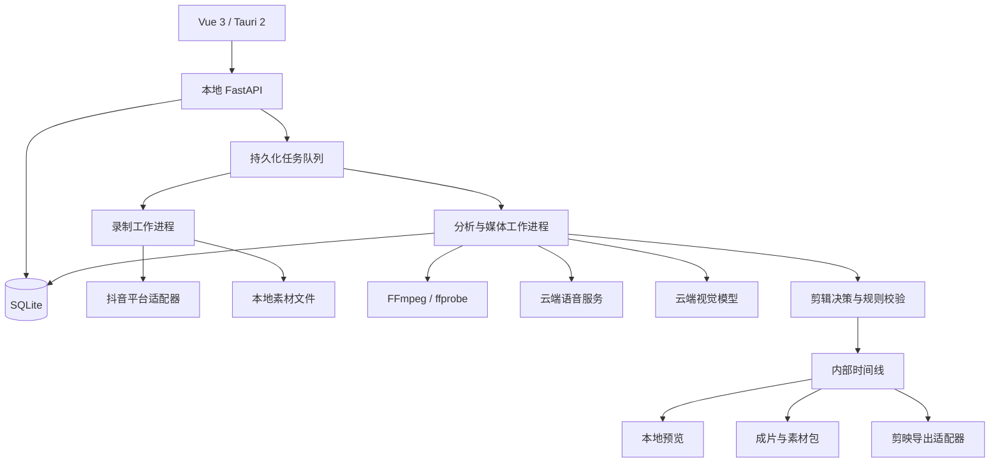

# 后续架构设计（历史方案留档）

以下保留 0.2.0 收敛前的长期设计，包含直播录制、视觉识别、跨款素材池和剪映工程。它们不是当前版本的实施或验收要求；旧的 10 秒 ASR、90 秒超时等参数已被当前 SPEC.md 替代。后续实施前需重新确认和更新规格。

## 1. 产品目标与已确认需求

工具持续保存抖音服装带货直播，每积累约 30 分钟录制素材启动一个分析批次，通过云端 AI 找出有用或符合用户要求的片段，按单款衣服组织成约一分钟的视频，支持预览、调整、成片导出及剪映可编辑交付。

| 项目 | 已确认需求 |
| --- | --- |
| 录制来源 | 通过直播链接抓取并保存到本地 |
| 工作方式 | 直播过程中分批产出，30 分钟素材为一个分析窗口 |
| 成片内容 | 单个视频只涉及一款衣服 |
| 成片时长 | 通常约 60 秒，可配置到约 90 秒 |
| 系统 | Windows 优先，第一版仅支持 Windows |
| 剪映 | 当前使用剪映专业版 11.6.0，后续通常更新到最新版 |
| 模型 | 全部使用用户提供或配置的云端 API，不部署本地 AI 模型 |
| 技术方向 | Python 为主，允许使用 FastAPI、Vue、Tauri 等 |
| 后续编辑 | 优先提供可在剪映中继续编辑的片段和工程 |

“30 分钟”是输入分析窗口，不是成片长度，也不代表从开始录制到产出只需要 30 分钟。云端处理和渲染会产生额外延迟；它们不应阻塞下一批素材的录制。

## 2. 第一版范围

### 2.1 必须包含

1. 本地视频导入，作为录制之外的输入和算法验证入口。
2. 一个直播间的持续录制、状态展示、断流重连和本地分段保存。
3. 每约 30 分钟自动建立分析批次；直播结束时处理剩余素材。
4. 云端中文语音转写、时间戳处理、画面采样与视觉理解。
5. 商品分段、同款素材归集、候选片段筛选和自然语言剪辑要求。
6. 每款独立生成约 60 秒的剪辑方案和自动预览；允许素材不足时等待补充。
7. 人工确认商品归属，预览片段，调整切点、顺序及字幕。
8. MP4 成片、独立片段、SRT 字幕和软件内部时间线导出。
9. 针对剪映 11.6.0 验证基础草稿导出；记录支持矩阵。
10. 持久化任务状态、进度、错误、暂停 / 恢复、取消、重试和分析结果缓存。

剪映工程导出是目标能力，但必须通过指定版本的实际验证后才能标记为支持；基础素材包仍需始终可用。

### 2.2 暂不包含

- 多直播间并行录制、多用户协作、云端素材管理中心。
- 本地 AI 推理、模型训练、自动微调。
- 秒级实时剪辑或直播画面实时回传。
- 完整非线性视频编辑器、多机位剪辑、复杂特效和高级转场。
- 自动配音、数字人、生成式画面、自动发布视频。
- 全平台直播解析、无回放的历史直播恢复。
- 同款批量生成大量混剪版本；数据结构保留后续扩展空间。

## 3. 实施默认值

以下是首版实现默认值，可由设置或后续规格变更调整，不是用户额外确认的要求。

| 配置 | 默认值及行为 |
| --- | --- |
| 分析窗口 | 1800 秒有效录制媒体时间 |
| 录制文件长度 | 目标 2～5 分钟；允许受关键帧和断流影响偏离 |
| 成片目标 | 60 秒，优先保留完整句子与动作，原则上允许约 ±15 秒 |
| 其他时长 | 支持设置 90 秒或自定义目标，采用软约束 |
| 多款输入 | 每款独立生成候选，不将不同款拼成一条视频 |
| 同款跨窗口 | 允许使用相邻批次已识别的同款素材 |
| 同款新素材 | 更新素材池；已有方案不自动覆盖，产生新版本或补充提示 |
| 价格、优惠、库存 | 提供分别控制的开关，初始模板倾向排除时效性信息 |
| 录制清晰度 | 可配置，默认优先选择可稳定录制且适合编辑的清晰度 |
| 画幅 | 跟随素材；竖屏素材默认保持原画幅 |
| 原声与字幕 | 保留原声，提供可编辑字幕及烧录字幕开关 |
| 预览 | 自动生成本地预览；最终导出由用户触发 |
| 素材删除 | 不自动删除源素材；用户主动清理，清理前检查工程引用 |
| 模型切换 | 默认不自动切换服务商，避免意外费用和不可控结果变化 |

素材不足时不应为了满足时长强行加入重复、无关或其他款式内容。可以生成明确标注的较短候选，或等待同款后续内容；产品界面需说明原因。

## 4. 用户流程与界面

### 4.1 初始化

用户选择素材保存目录、配置云端服务与凭据，检查 FFmpeg 可用性，选择剪映版本或允许检测。提供独立的模型连接测试，展示实际支持的输入方式和时间戳能力。

设置页充分使用侧栏外可用宽度，采用“模型连接”和“OSS”两张独立卡片。模型连接集中展示视觉、剪辑决策、语音模型 ID、共用 Base URL / API Key、语音开关、画面采样参数及聊天等待时间；OSS 展示存储参数和访问密钥。宽屏双栏，1150px 及以下单栏，600px 以下卡片内并排字段改为单列。两类配置分别保存，不提交或丢弃其他卡片的草稿；不再显示单独的百炼 ASR 卡片。

三类密钥输入框的小眼睛旁提供复制按钮，复制完整已保存密钥或当前未保存的新密钥草稿，保持输入框显示及草稿状态。隐藏显示值不进入剪贴板；完整值读取使用现有认证接口。成功后短暂显示对勾并提供辅助技术提示，失败显示可读错误；编辑或卸载期间到达的旧读取响应不会触发复制。

模型设置明确展示 Base URL、模型 API Key、视觉、决策和语音模型 API ID。默认 Base URL 为 `https://dashscope.aliyuncs.com/compatible-mode/v1`；视觉 / 决策走聊天兼容接口，语音走同一主机的 `/api/v1/services/aigc/multimodal-generation/generation`，三者共用模型密钥。语音默认 `qwen-audio-3.1-asr-flash`；旧 `paraformer*` 配置与未完成任务快照自动迁移，旧异步接口停用。模型 ID 去除首尾空白、限制为 1–100 个字母 / 数字 / 点 / 下划线 / 连字符，手动替换须兼容原生多模态音频协议。新任务读取保存配置；除上述迁移外，已有任务保留快照。已配置模型密钥优先；旧 DashScope 密钥仅在默认地址且无模型密钥时兼容作为共用凭据。密钥留空保留旧值。

密钥字段平铺展示，不通过下拉框选择类型。模型及 OSS 密钥均使用普通文本框，已保存密钥默认展示真实首尾内容，中间用固定五个星号隐藏（如 `sk-exa*****1234`），通过小眼睛查看完整值，再次点击恢复隐藏显示。点击 / 聚焦输入框保持当前显示，不自动清空；需要替换时，全选后输入新密钥或查看完整值后主动修改，再保存。隐藏显示值的部分编辑不进入替换草稿；留空不删除密钥，失去焦点后恢复隐藏显示。查看不触发保存。设置接口仅返回配置状态及隐藏显示值；完整密钥通过本地会话认证的独立显式查看接口返回，响应禁止缓存。保存后立即展示隐藏值；旧后端未提供显示元数据时，页面明确提示重启，兼容仅返回保存成功的旧接口并保留本次保存生成的隐藏值。

### 4.2 新建直播任务

粘贴直播间链接或含链接的分享文本，解析平台及直播状态，配置清晰度、批次长度、目标时长和剪辑要求，启动录制。展示录制状态、已保存时长、当前文件、断流情况及后台分析进度。

未开播、链接失效、需要登录或无法解析时，给出对应原因；只有公开直播地址而没有回放时，不能恢复开始录制之前的画面。

### 4.3 批次分析与审核

批次形成后自动排队分析。结果按款式展示：商品信息、候选视频、片段标签、原始字幕、入选原因、商品归属置信状态和素材不足提示。

审核支持：播放源片段、跳转对应时间、增删片段、重排顺序、微调切点、修正商品归属、编辑字幕、修改筛选要求并重新组片。重新组片优先复用缓存，而不是重新转写所有音频。

### 4.4 导出

选择成片、素材包或剪映工程。展示输出位置和结果；工程导出同时检查引用素材及版本兼容性。失败时保留剪辑方案，支持重试或输出基础素材包。

### 4.5 首版页面

| 页面 | 主要内容 |
| --- | --- |
| 任务页 | 直播录制、本地导入、任务状态、批次进度 |
| 商品素材页 | 按款素材池、标签、字幕检索、归属修正 |
| 剪辑审核页 | 播放器、候选片段、选择理由、顺序与切点调整 |
| 导出页 | 格式、画幅、字幕方式、兼容性、历史结果 |
| 设置页 | 保存目录、服务商、凭据、录制与处理参数 |

无需实现完整专业时间线编辑器；保留简化组片视图，将复杂编辑交给剪映。

视觉主题采用浅灰页面、白色面板、深灰侧栏和蓝紫色强调色。主按钮、选中态、焦点和进度条统一使用强调色；视频预览使用中性深色背景，避免影响服装颜色判断。错误提示采用浅红色，成功提示采用浅蓝色。

## 5. 总体技术架构

采用 Vue 3 + TypeScript + Tauri 2 桌面界面，本地 FastAPI 提供业务接口，独立 Python 工作进程执行录制、媒体处理与云端任务，SQLite 保存元数据和任务状态。



| 模块 | 选择与职责 |
| --- | --- |
| 桌面 | Tauri 2；管理本地服务生命周期、文件选择和应用窗口 |
| 前端 | Vue 3、TypeScript；媒体预览、审核与状态展示 |
| 前端包管理 | pnpm 10；packageManager 固定版本，pnpm-lock.yaml 纳入版本控制 |
| 接口 | FastAPI、Pydantic；参数校验、数据查询、任务控制 |
| 媒体 | FFmpeg、ffprobe；录制、探测、抽帧、音频提取、裁切与渲染 |
| 工作进程 | Python；与 API 进程隔离，录制与重型转码隔离 |
| Python 环境 | uv workspace；根目录统一管理 `.venv`、依赖组和 `uv.lock`，backend 为成员包 |
| 数据 | SQLite；单机元数据、任务领取、缓存及结果版本管理 |
| 模型 | 服务商适配器；保留各家上传、轮询、限流与结构化输出差异 |
| 导出 | 内部时间线分别转换为 FFmpeg 执行计划和剪映工程 |

第一版不强制引入 LangChain、LangGraph、Redis 或 Celery。复杂条件循环和人工恢复流程出现时可评估 LangGraph；多机器处理时再评估服务器任务队列。

## 6. 直播解析与录制

### 6.1 平台适配器

定义 `LiveSourceAdapter`，负责解析分享链接、判断直播状态、获取媒体地址和清晰度、刷新过期地址。可评估 StreamGet、DouyinLiveRecorder 等项目，采用前检查实际平台支持、维护状态和许可证。

录制执行与链接解析分离。直播地址、临时凭据或 Cookie 不进入通用业务日志，登录信息由用户主动提供或授权读取。

### 6.2 持续录制

- 使用 FFmpeg 保存完整音视频，优先转封装，避免录制时不必要的重编码。
- 选择适合中断恢复的分段容器；编辑需要 MP4 时再转封装。
- 正在写入的文件标记为未完成，不提交云端分析。
- 文件关闭后进行 ffprobe 检查，记录时长、码率、尺寸、音视频流和时间基准。
- 保留输入音视频时间关系，后续不能仅根据文件名推算切点。
- 断流后按退避策略重新解析并重连，记录缺失区间，不伪造丢失素材。
- 保存目录不可写或磁盘空间不足时停止继续写入并提示，保留已完成文件。
- 用户停止录制时正常结束 FFmpeg，封存当前文件，并默认处理剩余批次。

### 6.3 批次边界

以已保存、可探测的有效媒体建立约 1800 秒的逻辑批次。批次可以引用多个文件，不要求先拼出一个大文件。文件跨越批次边界时，以源区间引用切分。

批次等待对应文件封存，故启动分析可能略晚于墙钟第 30 分钟。断流情况下，墙钟时间和有效录制时长分别显示。

相邻批次可共享少量上下文帮助判断语句和商品边界；上下文不产生重复转写、重复索引或重复组片。跨批次商品内容依靠持续素材池保留，不只依靠固定重叠窗口。

## 7. 时间基准与媒体预处理

### 7.1 统一时间约定

- 业务接口和内部时间线使用整数微秒，后缀 `_us`。
- 所有区间使用左闭右开 `[start_us, end_us)`，且 `end_us > start_us`。
- 分别记录文件媒体时间、录制会话有效媒体时间和实际采集墙钟时间。
- 会话有效媒体时间允许累积已保存素材；断流缺失另行记录，不能将断流前后视为连续动作。
- 转写、抽帧和代理媒体必须保存到源文件时间的映射。
- 实际裁切与字幕落点按原媒体时间基准和目标帧率处理，不假设所有输入都是固定帧率。

### 7.2 预处理产物

每个源文件记录探测结果，按云端接口要求提取音频，生成浏览用代理媒体及带时间标签的抽帧。代理降低上传和预览成本，最终渲染使用原素材或经过验证的编辑素材。

视觉粗筛采用低频采样并辅以镜头变化检测；候选区间提高采样密度。服装面料、标签和细节画面保留更高分辨率，不统一压缩到无法辨认细节的尺度。

分辨率、采样率、上传片段长度均可配置，按供应商文件限制和真实素材测试确定默认值。云端直接视频输入与多图输入均通过适配器实现。

## 8. 云端 AI 设计

### 8.1 模型候选与选择原则

| 用途 | 候选 | 验证重点 |
| --- | --- | --- |
| 中文转写 | 用户指定阿里云 `qwen-audio-3.1-asr-flash` | 款号、尺码、数字、噪声下表现及字幕时间对齐；示例未提供句级时间戳 |
| 视觉理解 | Qwen2.5-VL 或供应商可用的后续 Qwen-VL 型号 | 换款、上身展示、细节、遮挡、多图 / 视频输入 |
| 国外视觉备选 | Gemini 视频理解型号，例如 2.5 Flash / Pro | 服装中文场景效果、延迟、文件输入与费用 |
| 剪辑决策 | 复用视觉模型，或 Qwen / DeepSeek 文本模型 | 遵循筛选要求、单款约束、结构化结果 |

语音模型已按用户提供的型号和 API 示例接入；视觉 / 决策仍采用用户可提供的型号。以上不构成最新型号或账号可用能力声明，需使用真实素材验证接口、成本和质量。

### 8.2 服务接口

定义 `ASRProvider`、`VisionProvider`、`EditPlannerProvider` 和可选 `CloudAssetTransport`。统一结果结构，保留供应商原始结果引用。

适配器需声明：支持的媒体输入、文件限制、时间戳粒度、结构化输出能力、异步作业方式、可用模型及费用统计能力。不能因接口兼容某种聊天格式，就假设视频上传和时间定位同样兼容。

需要文件 URL 时，支持供应商文件上传或用户配置的对象存储临时访问链接。避免反复上传相同素材，记录远端对象与到期时间，并提供缓存清理；本地服务不可假设能直接被云端访问。

云端错误保留独立的详情记录，涵盖语音、视觉与剪辑决策请求。区分超时 / 连接失败、非 JSON 响应、HTTP 错误、响应传输中断与结果结构校验失败；保存接口地址、模型、HTTP 状态、可取得的请求 ID / 响应类型、原因以及完整响应正文。密钥、Bearer 凭据与 URL 签名查询脱敏，不持久化请求中的图片或音频 URL。传输错误详情补充 operation（vision / planner / asr）、timeout_seconds、elapsed_seconds、image_count 与 request_bytes，不保存实际请求载荷。长正文不按任务摘要的 1000 字符限制裁断；未收到响应时明确显示无响应，传输中断标记为部分内容。

后台任务失败摘要旁显示错误图标；悬停 / 键盘聚焦后按需加载详情，点击可固定浮层，支持正文滚动、选中复制、关闭 / Escape 和加载失败重试。云端返回的 HTML / 脚本作为纯文本展示。详情写入 SQLite 的任务及尝试历史，任务列表与 SSE 仅携带是否有详情标记，避免重复广播长响应。详情接口沿用本地会话与 Origin 认证，禁止缓存。旧数据库自动补列，旧失败缺少正文时提示无法还原；不自动清除 ASR 不确定提交保护或重发请求。新增诊断只在更新后的请求发生错误时生效。

错误浮层明确区分三种来源：HTTP 客户端连接异常、云端 HTTP 响应、收到结果后的应用解析失败。应用 summary / 请求诊断与云端正文分开显示；reason 标明客户端原始异常或应用解析说明。RemoteDisconnected 单独归类，说明对端未返回 HTTP 状态 / 正文，不推断具体网关、服务或代理根因；无云端正文时不将诊断 JSON 冒充响应。兼容旧记录按 stage / reason 显示来源。

### 8.3 分析流水线

1. 对已封存音频按最多 10 秒分段，提取单声道 16 kHz PCM WAV，通过私有 OSS 签名 URL 同步转写；30 分钟最多 180 个请求，逐段更新进度。请求遵循用户示例：`input_audio.data` 为 URL，`parameters.format="wav"`、`sample_rate="16000"`，`X-DashScope-SSE: disable`。
2. 解析原生 `output.sentence` / `output.sentences` 或顶层同名结构，顶层与 output 重复结果仅解析一次；也兼容 `text` 与聊天式内容。完整句子的 begin_time / end_time 为上传音频段内毫秒，转换成源视频微秒（加分段偏移），标记 `timing=sentence`，验证整数、区间顺序与段内范围；拒绝未完成句子。words 不重复追加到句子文本。仅文本结果退回 `timing=audio_chunk` 粗略定位，并在设置与方案提示校准。字幕仅导出完整包含的句子或粗略段，被裁断的文本不猜测剩余文字，需人工补齐；不宣称已实现词级字幕或实测语音边界精度。
3. 对全部素材稀疏观察，识别商品变化、展示动作和无口播但有效的画面。单次视觉请求最多 8 帧（旧 24 帧任务快照也限制为 8），按 `(有效帧数上限-1)×采样间隔` 连续分窗口，保留窗口末尾帧与尾部素材，不能以减少输入为由跳过源区间。视觉 / 决策非流式请求的连接 / 读取等待默认 300 秒，模型连接中可配置 30–900 秒；语音仍为 90 秒。视觉输出上限 4096 tokens，决策 1024 tokens，不假设模型支持供应商专用推理开关。
4. 结合口播与画面形成商品区间及候选片段，不能只依赖关键词。
5. 对候选区域加强视觉分析，输出标签、证据及质量判断。
6. 根据商品归属、模板和用户要求选择片段并组织顺序。
7. 通过确定性规则验证，调整到句子、停顿和动作边界，保存版本化剪辑方案。

AI 负责理解与选择，时间映射、合法区间、单款约束和渲染由程序校验。

### 8.4 输出约束

- 结构化输出通过 Pydantic 校验，限制长度、枚举和区间范围。
- 模型只能选择提供的素材 ID 和已知时间范围，不能虚构素材或无依据时间点。
- 入选理由引用实际口播或画面证据，不把解释性文本直接写入成片字幕。
- 面料成分、价格、库存和尺码事实来自口播或用户资料；视觉推断需明确区分。
- 模型结果中的置信值只作为排序线索，未经评估不能视为准确概率。
- 对视频内口播、文字及 OCR 内容按素材数据处理，不能让其改变应用规则或执行指令。
- 输出异常可有限重试或进入人工处理；保留结果与错误，不能静默假装成功。

## 9. 商品素材池与剪辑规则

### 9.1 商品身份

优先依据用户商品信息、款号、明确商品名称，再结合口播上下文和视觉外观。仅凭颜色相似或外观接近不能自动认定同款。

模型提出商品归属，用户可确认、合并和拆分。身份不确定的片段进入未归属区。需要记录不同颜色和变体；首版默认同一成片保持同一款及同一变体，除非用户明确允许展示同款多色。

### 9.2 标签

候选标签包括：吸引开头、上身正面、侧面、背面、走动展示、面料特写、细节、版型、尺码建议、搭配、价格、优惠、库存、催单、无关互动、重复、静默、遮挡、模糊。

单个片段可具有多个标签，并同时记录文本、画面证据和质量因素。

### 9.3 组片约束

- 每条视频只包含一个已确认商品；变体规则见上。
- 优先完整表达、有效商品展示、口播和画面一致。
- 排除无关互动和明显无效内容；避免重复卖点及相似展示。
- 参考顺序为吸引开头、上身效果、核心卖点、尺码 / 搭配或自然收尾。
- 不通过拼接改变原意，不混接不同条件下的价格或尺码结论。
- 不以加速口播或加入无关内容作为默认时长补救。
- 跨文件或跨断流区间的动作不视为连续动作。
- 用户调整优先于自动结果，重新生成采用新版本，保留原方案。

片段去重结合源区间重叠、文字内容及画面相似度。允许用户明确复用片段，自动组片则避免重复。

## 10. 内部时间线与导出

### 10.1 内部时间线

内部时间线是唯一的剪辑方案数据源，不以剪映 JSON 作为核心业务格式。包含 `schema_version`、商品、源素材、源区间、目标位置、音量、画幅、裁切、字幕及模型证据引用。

示例仅说明最小结构，字段在实现时使用正式 Pydantic 模型：

```json
{
  "schema_version": "1.0",
  "plan_id": "plan_example",
  "product_id": "product_example",
  "revision": 1,
  "target_duration_us": 60000000,
  "canvas": { "width": 1080, "height": 1920 },
  "clips": [
    {
      "source_asset_id": "asset_example",
      "source_start_us": 12000000,
      "source_end_us": 20000000,
      "timeline_start_us": 0,
      "candidate_id": "candidate_example",
      "audio_gain_db": 0
    }
  ],
  "subtitles": [
    { "start_us": 0, "end_us": 2000000, "text": "实际转写并审核后的字幕" }
  ]
}
```

示例只有一个片段，不代表完成 60 秒组片。字幕时间使用输出时间线，必须从源字幕经过切点及排序映射生成；删除的源区间不能遗留字幕。

### 10.2 MP4 与素材包

- 最终成片默认采用兼容性较好的 MP4 / H.264 / AAC，实际编码参数经验证后配置。
- 目标画幅跟随素材，不默认拉伸或裁掉衣服主体；输出 1080×1920 不代表对低清素材自动提升有效画质。
- 精确裁切按需要重编码，不依赖流复制获得任意帧准确切点。
- 统一参与拼接素材的分辨率、像素格式、帧率及音频参数，校验音画同步。
- 素材包包含编号片段、整条字幕、必要时的片段字幕、内部时间线和素材清单。
- 不烧录字幕时保留 SRT；烧录字幕与剪映可编辑字幕是不同交付方式。

### 10.3 剪映工程

单独实现 `JianyingExporter`。可用现有 jianying-editor / JyWrapper / pyJianYingDraft 做可行性验证，但实际依赖选型以目标版本测试结果为准。

第一阶段工程只要求基础视频片段、源切点、排序、原声、画幅和可编辑字幕。工程可引用原素材，也可使用带额外可调整余量的裁切素材；导出时记录实际策略。

素材包保留相对路径清单，导出适配器按目标目录生成剪映需要的路径；移动目录时提供重新定位 / 修复引用能力。不能假设剪映支持直接使用相对路径。

兼容状态明确区分 `verified`、`untested`、`unsupported`，并记录剪映版本、导出器版本和验证日期。未验证版本不得显示“保证兼容”。

任何工程写入均创建独立项目，不覆盖用户已有草稿或共享模板。工程生成成功与剪映打开成功是两项不同验证。

## 11. 核心数据模型

| 实体 | 关键内容 |
| --- | --- |
| RecordingSession | 平台、输入链接、录制配置、状态、墙钟时间、有效媒体时长 |
| SourceAsset | 路径、内容标识、探测信息、封存状态、会话时间映射 |
| RecordingGap | 断流起止、原因、重连结果 |
| AnalysisBatch | 素材区间列表、批次状态、上下文引用、分析配置版本 |
| TranscriptSegment | 源区间、文本、时间戳粒度、服务商与结果引用 |
| VisualObservation | 帧 / 视频区间、标签、证据、模型与配置 |
| Product / Variant | 款号、名称、变体、身份来源、人工确认状态 |
| CandidateClip | 商品归属、源区间、标签、质量、入选理由与证据 |
| EditPlan | 内部时间线、目标时长、筛选要求、版本、审核状态 |
| Job | 类型、状态、依赖、尝试次数、租约、进度、错误和产物 |
| ExportArtifact | 格式、路径、引用素材、验证状态、兼容信息 |
| ProviderConfig | 服务商、接口地址、模型、能力；只保存凭据引用 |

缓存键由素材身份与区间、预处理参数、模型 / 服务版本、提示词版本和结果格式版本共同确定。改变剪辑要求只失效组片缓存；改变模型或采样参数只失效对应分析阶段。

## 12. 任务调度与状态

### 12.1 工作进程

录制进程独立于分析和渲染，优先保障持续保存。SQLite 中持久化待执行任务，使用事务领取及租约心跳，防止多个工作进程重复执行。

SQLite 可采用 WAL 和合理的忙等待配置；保持写事务短，不将长时间模型调用放在数据库事务内。每个工作进程独立创建数据库连接。

云端网络请求允许有限并发；本地转码默认低并发，避免抢占录制资源。并发参数可配置，不承诺所有硬件下固定速度。

### 12.2 状态

- 录制：`created → resolving → recording → reconnecting → stopping → stopped / failed`，重连成功返回 `recording`。
- 后台任务：`queued → running → waiting_remote → succeeded / failed / cancelled`，异步任务恢复后回到执行或等待状态；另支持 `pause_requested → paused`，恢复后回到可继续执行的阶段。
- 剪辑方案：`generated → needs_review → approved → exporting → exported`；素材不足或归属不确定另行标记。

失败重试新建尝试记录；成功阶段不重复执行。重启后恢复过期租约，并优先查询已提交的云端作业，避免重复计费。无法确认远端提交结果时明确标记，不盲目重提。

产物先写临时文件，探测完成后再发布；重复任务不覆盖不同版本产物。取消分为本地停止和供应商支持的远端取消，说明远端作业可能已产生费用。

Qwen 同步音频请求区分明确拒绝（如 HTTP 401 / 403 / 429）与不确定结果（超时、HTTP 408 / 5xx）。明确拒绝写为 `rejected`，修正后可重试；不确定请求保留 `submitting` 并禁止自动重复提交，需核查模型请求记录。按源摘要、源区间、接口主机与模型逐段缓存文本及逐句时间，空文本作为静音缓存；旧成功纯文本缓存继续按粗略时间复用，不自动重新付费识别。不兼容响应明确报错且不缓存成功。旧 Paraformer 缓存保留但不复用或继续查询。新分析完成后在同一事务替换该素材源转写与发布结果，避免旧 / 新字幕重复；失败不会发布半套转写。

分析暂停在阶段边界生效，已提交的远端作业可能继续运行并计费，需保存作业 ID 和结果。录制暂停采用停止当前采集并封存文件的方式，恢复时记录新采集区间和缺失区间；不能补回暂停期间未保存的直播。

窗口关闭时，正在录制的任务需有明确行为：首版优先提供最小化到托盘继续运行，以及停止任务后退出。系统休眠、网络断开和应用重启均记录状态；不能承诺应用关闭后仍持续录制。

## 13. 本地接口与目录约定

接口使用 `/api/v1` 前缀，ID 为不依赖文件路径的稳定标识。所有长任务返回任务 ID，不等待完整处理完成。

普通 API 与 SSE 实时连接通过共用请求入口携带本地会话令牌请求头，并保留 Cookie 支持。实时连接使用 fetch 流读取，令牌不放入 URL；401 / 403 停止重连并提示刷新或重新打开统一启动器，网络中断采用有上限的退避重连。页面卸载取消流读取与待重连操作。

| 接口 | 用途 |
| --- | --- |
| `POST /sessions` | 创建直播录制任务 |
| `POST /sessions/{id}/start` | 启动录制 |
| `POST /sessions/{id}/stop` | 停止并按配置处理剩余素材 |
| `POST /assets/import` | 导入本地文件 |
| `GET /jobs` / `GET /jobs/{id}` | 查询任务与进度 |
| `POST /jobs/{id}/retry` / `cancel` | 重试或取消 |
| `POST /jobs/{id}/pause` / `resume` | 请求暂停或恢复后台处理 |
| `GET /batches` / `GET /products` | 查询批次与商品素材 |
| `GET /candidates` | 按商品、标签、文本筛选片段 |
| `PATCH /candidates/{id}` | 修正归属与候选标注 |
| `POST /plans` | 按商品与要求生成剪辑方案 |
| `PATCH /plans/{id}` | 保存人工修改为新版本 |
| `POST /plans/{id}/approve` | 审核确认 |
| `POST /plans/{id}/exports` | 创建导出任务 |
| `POST /providers/test` | 验证服务配置 |
| `GET /events` | SSE 推送录制及任务状态 |

媒体预览接口需支持范围请求，通过素材 ID 定位允许访问的文件，不提供任意路径读取。分页、错误码、请求追踪标识和配置校验采用统一格式。

建议代码组织：

```text
DouyinCut/
  SPEC.md
  backend/
    app/
      api/ domain/ storage/ jobs/
      ingestion/ media/ providers/ analysis/ editing/ exporters/
    tests/
  desktop/
    src/
    src-tauri/
  scripts/
  docs/
```

用户数据存储目录可配置，建议包含 `database/`、`recordings/`、`proxies/`、`analysis/`、`previews/`、`exports/` 和 `logs/`。缓存和素材不提交源码仓库。

## 14. 配置、凭据与诊断

- API 默认只监听本机回环地址，使用会话令牌并限制允许的前端来源。
- 云端密钥存入 Windows 凭据管理器或经验证的系统凭据存储，不写入仓库、普通配置或工程包。
- 日志隐藏 Cookie、API Key、签名 URL 和包含凭据的请求字段。
- FFmpeg 参数使用参数列表传递；不把用户输入拼接为 shell 命令。
- 配置分为应用、录制、预处理、供应商、剪辑模板和导出六类，保留配置版本。
- 日志关联会话、批次和任务，记录错误阶段、可重试性与产物位置。
- 云端调用记录可获得的用量、延迟与费用数据；缺少官方单价或统计时不展示虚构精确费用。
- 设置上传大小、调用并发和重试上限；支持可配置的费用 / 用量提醒。
- 数据清理检查所有导出工程引用，避免删除仍被工程使用的素材。

## 15. 非功能要求与评估指标

### 15.1 可靠性

录制、分析和导出分别运行和恢复；单一云端任务失败不能终止持续录制。成功阶段结果可复用，用户修改要求不需要重复全部处理。

### 15.2 性能与费用

不在验证前承诺固定分析时间、费用或采样率。实测并记录 30 分钟批次的上传时间、ASR 延迟、视觉分析延迟、组片延迟、渲染耗时和完成总延迟。

统计源素材大小、上传量、请求次数、模型用量和各阶段缓存命中率。录制优先，积压任务显示排队状态。

### 15.3 识别质量

使用用户代表性服装直播建立人工标注测试集，至少覆盖多款切换、同款多色、跨窗口、重复口播、噪声、无口播展示和模糊遮挡。

关注商品分段正确率、误混款、好片段漏检、无效片段混入、切断句子 / 动作、字幕与声音偏移、成片有效内容比例和人工修改耗时。数值阈值在原型实测后补充，未设阈值前不能宣称识别质量已量化达标。

### 15.4 发布

Tauri、Python 和 FFmpeg 依赖需分别完成 Windows 打包测试；软件总体体积包含这些运行时，不能只依据 Tauri 外壳估算。检查 FFmpeg 发行版及第三方库许可证。

至少在一台干净 Windows 环境验收安装、启动、中文 / 空格路径、播放、录制及导出。WebView2 对输入编码的支持须实测，必要时提供预览代理。

## 16. 验证优先级与开发里程碑

### M0：风险验证

1. 真实直播链接解析与分段录制：验证清晰度、过期地址、断流恢复和文件可播放性。
2. 真实服装素材分析：比较 ASR 与视觉服务，验证单款归属、有效内容和切点。
3. 剪映 11.6.0 基础草稿：三段视频、原声、可编辑字幕，验证打开、修改、保存和导出。

输出验证记录、模型候选对比、剪映兼容矩阵及规格修订。若草稿验证失败，明确报告限制与替代交付，不以生成 JSON 文件视为完成；核心时间线与基础导出可继续开发。

### M1：核心处理链

实现内部数据模型、文件导入、媒体预处理、云端适配器、商品索引、候选片段、剪辑时间线与 MP4 / SRT 输出。先以本地代表性素材稳定验证。

### M2：持续直播链

接入直播解析、分段录制、30 分钟批次、跨批次素材池、剩余批次处理、重试与恢复。

### M3：桌面审核

实现 Vue / Tauri 页面、任务进度、候选预览、商品修正、切点与顺序调整、版本化方案、设置和凭据管理。

### M4：工程交付与发布

完成已验证剪映版本的草稿导出、素材包与引用修复，执行真实场景验收、故障测试和 Windows 安装包测试。更新支持矩阵和使用文档。

## 17. 首版验收场景

| 场景 | 验收结果 |
| --- | --- |
| 持续直播超过 30 分钟 | 已完成首批进入分析，后续直播继续保存 |
| 直播不足 30 分钟结束 | 已保存素材仍形成尾批并得到可解释结果 |
| 一批包含多款 | 按款生成候选，任何自动成片不混入其他已知款 |
| 商品跨 30 分钟边界 | 同款内容正确归集，源切点可回溯，不重复处理重叠上下文 |
| 同款不同颜色 | 记录变体并遵循默认单变体规则，允许人工更正 |
| 素材不足 / 无有效片段 | 标明原因，不填充无关内容，不伪造成功视频 |
| 修改“去掉价格”等要求 | 复用已有索引，产生新方案且保留人工旧版本 |
| 云端超时 / 限流 | 分析进入等待或失败状态，录制继续，支持有界重试 |
| 断流 / 地址失效 | 保存完整旧段，尝试重新解析，记录缺失区间 |
| 程序重启 | 已保存素材和方案存在；任务恢复不盲目重复提交远端作业 |
| 精确裁切与字幕 | 成片无明显音画不同步，字幕对应输出片段，不残留被删除内容 |
| 素材包 | 片段独立可播放，编号与时间线一致，SRT 可读取 |
| 剪映 11.6.0 | 已验证工程可打开、改切点、编辑字幕、保存和导出 |
| 未验证剪映版本 | 明确显示兼容状态，仍可导出基础素材包 |
| 中文 / 空格路径 | 录制、预览、导出及工程引用均可正常使用 |

自动测试重点覆盖时间映射、跨批次归集、单款约束、字幕重排、任务幂等与恢复；模型质量用人工标注素材评估，剪映兼容性用实际应用验证，不能以模拟测试代替。

## 18. 待验证事项与决策记录

| 事项 | 当前状态 | 后续处理 |
| --- | --- | --- |
| 抖音解析依赖 | 未选定 | M0 用实际链接比较可用性、维护状态及许可证 |
| 云端 ASR / 视觉供应商与型号 | 阿里云；语音按用户指定 `qwen-audio-3.1-asr-flash`，视觉 / 决策默认候选 `qwen3.8-flash` | 接口按用户示例实现，真实权限、效果、成本与延迟待验证 |
| 云端上传方式与对象存储 | 未选定 | 随选定供应商确定，保持可替换适配器 |
| 剪映 11.6.0 草稿格式 | 未验证 | M0 以实际打开、修改与导出验证 |
| 剪映后续最新版 | 持续验证 | 每个版本记录支持矩阵，不承诺无条件兼容 |
| 商品识别阈值、采样率 | 未量化 | 用代表性素材校准，优先降低误混款 |
| 默认价格策略、变体策略 | 实施默认值 | 用户可在模板中调整，试用后可修订 |
| 产品正式名称、安装包细节 | 暂定 | 不影响核心原型，发布前确定 |

已确定的架构决策：Python 为业务核心；全部 AI 使用云端；Windows 桌面优先；录制与处理隔离；按 30 分钟输入窗口调度；约 60 秒单款组片；内部时间线独立于剪映；人工审核后最终交付。

